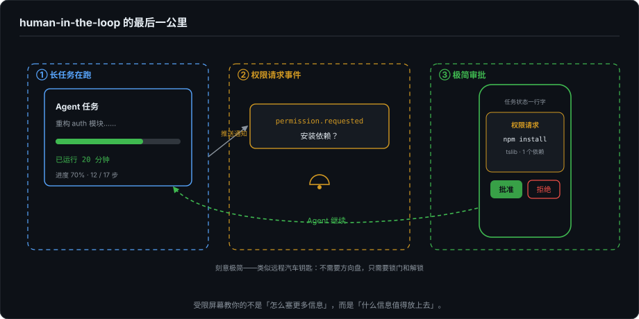
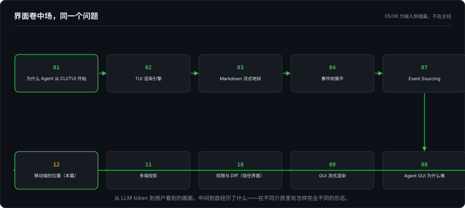

# 移动端的位置

> 「界面」卷的中场。写作时本想在这里收束，后来没收住。前十一篇从 ANSI 序列一路讲到多端架构。这一篇先说移动端在 Agent 产品里的位置，再回头给这十一篇画一张地图。原先接在后面的个人经验部分，成书时挪到了本卷卷末。

---

## 一、移动端在 Agent 产品中的位置

先说清楚，移动端不适合做 Agent 的主执行入口（虽然我个人非常偏爱移动端），原因是结构性的，远不止"屏幕小"：

- **长运行**：Agent 的一个任务可能跑 20 分钟。iOS 的后台限制让长运行进程几乎不可能。
- **高密度文本**：diff、日志、堆栈，这些在 6 寸屏幕上阅读体验极差。
- **本地工具链**：编译器、包管理器、git，手机上跑不了完整的开发环境。
- **平台政策**：App Store 禁止 App 下载并执行改变自身功能的代码（2.5.2），2026 年已因这条下架多个 vibe coding 应用。
- **散热**：持续高负载 = thermal throttling = 恶性循环。
- **内存经济**：AI 浪潮把存储产能吸向 HBM，DRAM 合约价一路疯涨，"大内存手机"越来越奢侈；Agent 偏偏是内存饥渴型负载。两条曲线是反着的。
- **安全边界**：手机是身份中枢，银行、2FA、通讯录都在上面。让 Agent 在上面跑任意工具，一次注入攻击的代价是身份沦陷。桌面可以沙箱、可以重装，手机不行。

但移动端有一个不可替代的位置：**human-in-the-loop 的最后一公里。**

用户离开电脑。Agent 在后台继续跑（Mac 上跑着本地 daemon，或者远程服务器上跑着 Agent）。碰到一个需要确认的操作，移动端推一条通知。用户看一眼，知道 Agent 在做什么，批准或拒绝。Agent 继续。

这不是"把桌面端缩小"。移动端的 Companion 应该极简：当前任务状态、最近一次权限请求、一键批准/拒绝。类似远程汽车钥匙：不需要方向盘，只需要锁门和解锁。

从移动端交互经验里带过来的一个观点：**在手机这个受限屏幕上，要考虑的是取舍：什么信息值得放上去，什么该砍掉。**

这种克制，在做 Agent 的任何一端时都用得上。

---

## 二、中场地图

界面这一卷走到中场，回到系列的开头看一眼。前十一篇，从 ANSI 转义序列写到多端架构，回答的是同一个问题：

> **从 LLM 输出 token 到用户看到的画面，中间到底经历了什么，以及这个经历在不同介质里有怎样完全不同的形态。**

第 1 篇问：为什么 Agent 从 CLI/TUI 开始？答案不是 GUI 不好，是因为当前最硬的问题不在界面表达，在执行过程不确定、权限边界敏感、本地工程环境复杂。CLI/TUI 以最低成本解决了当前最硬的问题。

第 2–4 篇展示了这套"最低成本方案"底下的真实代价，第 5–6 篇补上了输入侧。第 7 篇把问题抽象为 Event Sourcing 框架。第 8–9 篇展示了同一套问题进入 GUI 世界后的新形态。第 10 篇是跨端的信任设计，权限与 diff 这两块"信任界面"，才是 Agent 的主界面。第 11 篇回到全局，多端并存才是终态。

如果这个系列在读者心里留下了一件事，我希望是：

> **Agent 的界面是为一种全新的执行体（不确定、长运行、可中断、可审计、会调用工具）设计的工作流界面，不是聊天框的变体。**这个领域需要的是同时理解终端渲染、事件系统、权限模型、diff 审查和本地开发环境的工程师，而不只是会写聊天 UI 的前端。

---

## 三、中场总结

写到这里，界面这一卷的中场到了：问题域从像素一路摊到多端。但内容本身还有很多可以深入的点，当时列了一张清单：权限模型的信任规则 DSL、diff 审查面板的具体交互稿、多端 event log 的同步协议、Mobile Companion 的推送通道设计。

成书时回头看，清单上已有两项兑现，而且都不在界面这一卷：多端 event log 的同步与重连，写成了基建卷的《连接与会话》；推送通道和移动端的架构条款，写成了《一条消息的生命线》与《移动端的架构代价》上下篇。界面层提的问题，答案长在下面一层。本卷中场之后也没停在原地：第 13 到 19 篇从渲染的所有权一路写到状态行、回归测试和渲染的信任边界，卷末再回到人；再往下，胶水层、基建、评测各自成卷。
