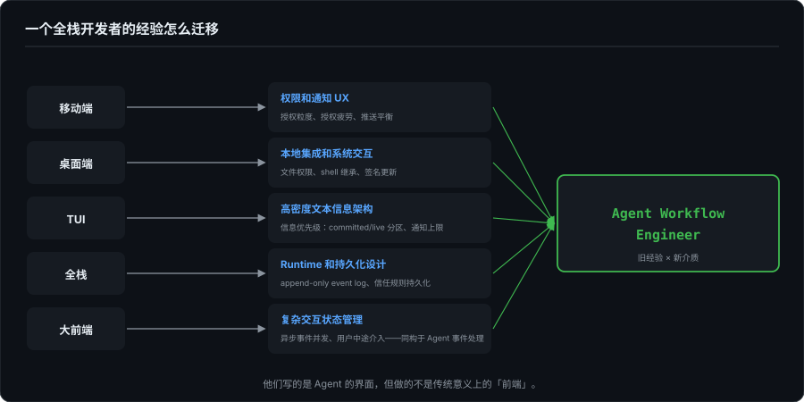

# 从大前端到 Agent Workflow Engineer

> 界面卷的最后一篇。前面十九篇讲的是界面怎么做，这一篇回到人：做移动端、桌面端、TUI、全栈这些经验，在 Agent 时代到底意味着什么。这部分原本是第 12 篇的后半，成书时挪到了卷末。

---

## 一、一个全栈开发者的经验怎么迁移

这几项我都做过，移动端、桌面端、TUI、全栈。回头看，每一项在 Agent 时代都有直接的迁移路径：

**移动端 → 权限和通知 UX。**  
移动端的天性就是处理权限：相机、定位、通讯录、通知。授权粒度怎么分（以定位权限为例：授权状态其实只有"使用期间 / 始终"两级，弹窗上那个"允许一次"是临时的"使用期间"，App 停止使用后失效；而且首次弹窗根本没有"始终"选项）、授权疲劳长什么样、推送通知的触达率和骚扰率之间怎么平衡，这些是移动端开发者的日常。

**桌面端 → 本地集成和系统交互。**  
文件系统权限、shell 环境继承、code signing、auto update、crash recovery，第 1 篇和第 8 篇反复提到的 GUI 额外成本，做桌面端的时候我已经交过学费了。Agent Desktop App 是这些经验的直接应用场景。

**TUI → 高密度文本信息架构。**  
写 ForgeLoopTUI 的过程，就是在一个只有字符的终端里把信息组织清晰的过程，靠的不是像素能力，是信息优先级。什么该放 committed 区、什么该放 live 区，通知超过 3 条就该移除，这些判断是在字符网格里逼出来的，框架给不了。这套判断力在 GUI 上同样适用，信息多了，Panel 不会帮你自动排优先级。

**全栈 → Runtime 和持久化设计。**  
Event log 的 append-only 模型、权限引擎的信任规则持久化、Workspace 状态管理，这些不是 UI 问题，是后端问题。全栈经验让我能同时理解 Agent 的 Runtime 层和投影层，不用只做其中一半。

**大前端 → 复杂交互状态管理。**  
大前端的核心能力不是"会写多个平台"，是**管理复杂交互状态**：一个操作触发多个副作用、多个异步事件并发到达、用户中途介入改变状态流向。这和第 4 篇拆解的 Agent 事件处理模型是同一种能力。我在 ForgeLoopTUI 里手写的 `pendingTools` 稳定槽位队列 +  `shiftIndices` 偏移追踪，回头看就是一个手动实现的响应式状态管理系统。

---

## 二、新岗位方向

如果"Agent 时代的开发者界面"成为一个独立的专业领域，这些岗位可能会出现或已经在出现：

**Agent Workflow Engineer。**  
不设计聊天框，设计 Agent 的工作流界面：工具调用时间线、权限审批流、diff 审查面板、多任务编排。需要同时理解 Agent 的执行模型和 GUI 的交互模式。

**AI DevTools Product Engineer。**  
介于产品经理和工程师之间，不需要手写 ANSI 状态机，但需要知道物理行计算为什么让增量 diff 翻倍复杂。在工程约束和用户体验之间做判断。

**Local-first Agent Platform Engineer。**  
Agent 核心跑在用户机器上，event log 本地持久化，隐私和延迟优于云端方案。需要桌面端开发经验 + Runtime 设计能力。

**IDE / CLI Integration Engineer。**  
把 Agent 嵌入开发者的现有工具链，不另起 Agent 专属界面，让 Agent 在 VS Code、终端、git 工作流里自然出现。

这些方向现在还处于早期。但回头看第 1 篇列的那个名单（Claude Code、Codex CLI、Gemini CLI、Goose、Aider、Devin CLI、Qwen Code），每个项目背后都需要这样的人（名单的时间锚点、以及到 2026 年秋天各家 GUI 的进展，见第 1 篇的补记：界面在变多，这类岗位的需求只多不少）。他们写的是 Agent 的界面，但做的不是传统意义上的"前端"。

---

界面卷到这里结束。下一卷是胶水层，从界面往下走一层，看界面和引擎之间怎么对话。
