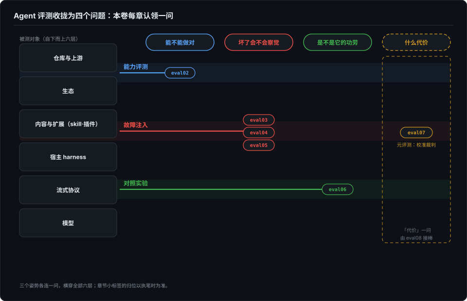

# 没报错只是开始——行为的可断言性

> 全书开篇问过：没报错，就代表输出没问题吗？界面部分第 16 篇回答了这个问题的一半——渲染层，把带状态的字节流逐层翻译成可以断言的东西。但 agent 不只是会说话，它会做事：行为层的可断言性是另一个量级的难题。这一篇是本卷的地图：把「agent 评测」这团乱麻收拢成四个问题，后面每章认领一问。

## 本章将讲

- agent 断言难在三件事：**非确定性**——同一输入不同输出，断言目标从结果移到路径覆盖与终态；**成本是一等约束**——每个样本都是真金白银；**被测对象是复合体**——模型 × 脚手架 × 工具 × 内容，归因必须靠对照。
- 四问框架：能不能做对、坏了会不会察觉、是不是它的功劳、什么代价——也是本卷后续各章的目录。
- 「什么代价」一问只立框架不展开：成本怎么进入 go/no-go 裁决，由第 8 篇接棒。

## 一、已经回答的那一半

先把已经到手的半个答案数清楚。

基建卷 prologue 把「看起来完整」拆穿了一次：流式回答被截断，渲染出来毫无破绽——没报错，不代表没问题。那一篇的结论是判定必须下沉到协议层，complete 只能是排除出来的兜底，不能是默认值。界面部分第 16 篇再进一步，把渲染层的输出整个变成了可断言的：字节断言钉契约、快照钉形态、等价性钉不变量、守护测试钉纪律。到那一篇为止，「agent 说的话显示得对不对」这个问题，从字节到纪律每一层都有了断言形态。

但注意这两篇共同的幸运之处：**被测对象是确定的。** 渲染引擎喂同一段字节，产出必须逐字节相同；不等就是 bug，断言就地正法。prologue 的完整性状态机也一样——字节到没到、到全没有，是有标准答案的。这个幸运到行为层为止。agent 的「输出」不是一段文本，是一连串动作：改了哪些文件、调了哪些工具、为什么这个顺序、中间信了哪条记忆。同一道题喂两遍，动作序列可以完全不同，而**两次都对**。界面的半边有 oracle，行为的半边没有。

prologue 结尾立过一面旗：流行的评测框架把指标分成结果、过程、效率、风险四层，而「答案被截断却看起来完整」这种故障哪一层都放不进去——它不改变 agent 的行为，只改变你看到的是不是真的。四层评的是能力，它考问的是评测的地基。这一卷，就是来接这面旗的。

## 二、行为层难在三件事

**第一难：非确定性。** 断言的前提是「正确答案存在且可枚举」。渲染层有，行为层没有。同一输入不同输出，断言目标只能从「结果」搬走——搬到路径覆盖（该走的步骤走了没有）和终态（不管过程怎么抖，最后落库的状态对不对）。这是断言目标的两次搬家；第 11 篇还会补第三次：断言不了输出，就断言输出之间的关系。三次搬家有一个共同的方向——离「逐字比对预期值」越来越远，离「这个系统必须保持的性质」越来越近。

非确定性还带来一个统计后果：单次成功说明不了什么。一个 agent 跑一遍成功，是灵感还是能力？τ-bench 给过一个官方口径的注脚——它不看单次 pass，看 pass^k：k 次独立运行**全部**成功的概率，把「可靠性」从一次灵感里拆出来。同一个 0.75 的单次成功率，可以是每次都四分之三的稳，也可以是时灵时不灵的赌——这两种 agent 是两种产品。第 6 篇会把 pass@k 与 pass^k 这对指标讲透，这里只立一句：**本卷所有结论都以「跑多次」为前提，单次跑分不作数。**

**第二难：成本是一等约束。** 界面层的测试是免费的：八百个快照文件，跑一次 CI 几秒钟，断言随便加。行为层反过来——每跑一次实验都是真金白银的 token，每个样本都是一次付费会话。这改变了评测的形状：样本量不由统计愿望决定，由预算决定；「再跑一万次取平均」这个选项不存在；连「这个实验值不值得跑」本身都成了一个需要裁决的问题。成本怎么进入 go/no-go 决策、账怎么记才不污染归因，这一问本篇只立框架，展开交给第 8 篇。

**第三难：被测对象是复合体。** 测 agent 从来不是只测模型。一次运行的结果是模型 × 脚手架 × 工具 × 内容的乘积：换了 harness，同一个模型判若两人；同一段系统提示，写在 description 里和写在正文里效果天差地别（第 2 篇有实测）；skill 文件被截掉三分之一，有的宿主当场翻车有的毫无察觉（第 4 篇）。所以本卷几乎不谈「这个模型行不行」，只谈「这个差异能不能归因」——而归因的最低配置是对照，这是第 6 篇的主题。

## 三、被测对象的六层

复合体具体是哪几层？把全书的病例摊开，被测对象自下而上正好六层：

- **模型**：权重里的能力。榜单和基准的主战场，本卷着墨最少——不是不重要，是「只测这一层」的幻觉最害人。
- **流式协议**：字节的到达与完整。prologue 整篇是这一层的病例：截断的回答看起来完整。
- **宿主 harness**：循环、重试、兜底、权限。基建卷三篇在讲它；本卷第 3 篇讲它的另一面——静默降级如何让实验根本没发生。
- **内容与扩展**：skill、插件、规则文件、记忆。第 4 篇的故障注入炸弹就埋在这一层。
- **生态**：别人的插件、别人的评测、别人的榜单。第 6 篇的战场。
- **仓库与上游**：被测代码本身。第 5 篇把故障注入从 skill 推到仓库，靠的就是这一层的 88 份原始记录。

六层都能坏，且坏法各异；同一层修好了不代表相邻层没事。这张地图的用处是反着用的——拿到任何一个评测结论，先问：它测的是哪一层？结论能外推到哪一层？

## 四、四个问题，三个姿势

地图的右半边是四个问题，本卷每章认领一问：

1. **能不能做对**——能力评测。但「做对」的前提是考题合法：考题从哪来、凭什么存在，是第 2 篇。
2. **坏了会不会察觉**——故障注入。第 3 篇先讲最便宜的失败（实验根本没发生，绿灯照样全绿），第 4 篇把炸弹真的埋下去，第 5 篇从战例里抽出检出率的乘法模型。
3. **是不是它的功劳**——对照实验。第 6 篇讲归因的最低配置，第 9 篇是把对照落到地面的操作手册。
4. **什么代价**——质量与成本的联合裁决。本篇只立框架，第 8 篇接棒。

四问之外还有一问，问的是评测自己：裁判会不会错？会，而且裁判的 bug 比被测对象的更隐蔽——第 7 篇用我自己的一次公开翻案收口，那是本卷的元评测章。第 10 篇把整套方法搬进一个具体领域（记忆），第 11 篇补上断言形态的第三块拼图（蜕变测试）。十个章号，四问加一面镜子。

三个姿势各连一问，但姿势不是章的私有财产：能力评测里有注入（第 2 篇的红绿对照就是注出来的），故障注入里全是微型对照实验。地图画的是主雇关系，不是围墙。

## 五、本卷的叙事弧与公理

交代一下本卷的口气。和界面卷拿 ForgeLoopTUI 当参照系一样，本卷的参照系是我自己的评测工具链：dsh-eval-harness、skill-quake 故障注入管线、108 格截断矩阵。叙事弧大致是：先拿自己的 harness 当尺子，再拿尺子去量别人的生态，然后发现尺子本身的刻度是错的，最后把「修正尺子」长成纪律。所以本卷的病例大多是我自己的翻案记录——这不是自曝家短的癖好，是本卷的公理决定的：

**评测的全部产物——考题、观测、对照组、裁判——自己也是软件，也会坏，也需要被测。** 每一章既是拿评测问 agent，也是拿这句公理问评测本身。第 7 篇的「错误 → 机制化」清单，就是这句公理逐章兑现后的总账。

## 参考与延伸

- *本章为全卷框架章，无对应博客篇；四问框架与六层划分浓缩自作者的私人评测全景笔记（未公开，仅作骨架来源，不作事实出处）。*
- *τ-bench 的 pass^k 口径见其论文原文（Sierra 团队的 Tool-Agent-User 交互基准）：以 k 次独立运行全部成功的概率度量可靠性，并以数据库终态做判定——「可靠性而非一次灵感」与「看终态」两条均与本卷互指。*
- *prologue 之问见基建卷 prologue；渲染层的四层断言翻译见界面部分第 16 篇，本章引用不重讲。*
