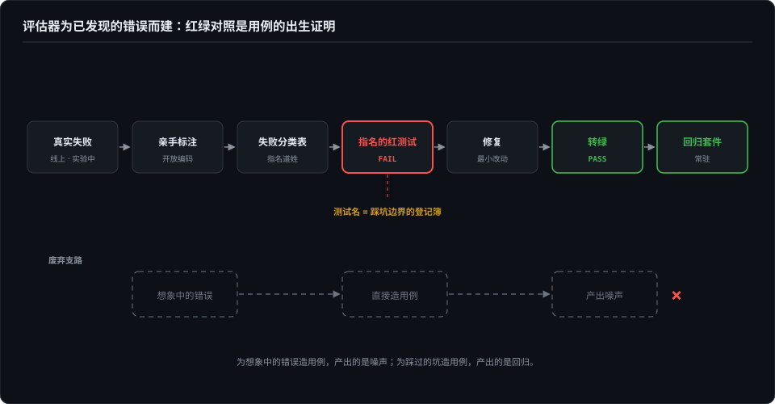
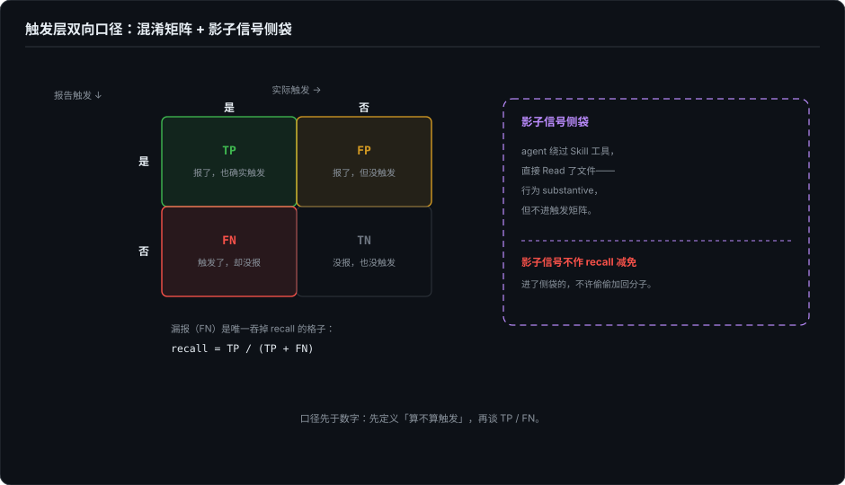

# 考题从哪来——为真实失败而建

> 评估器该为已发现的错误而建，不为想象中的错误而建——想象中的错误测出来，全是噪声。这一篇讲用例的来源哲学：一条评测用例凭什么存在。

## 本章将讲

- 红绿对照：用例的合法出生证明——每个修过的 bug 配一条 FAIL→PASS 用例，与 SWE-bench 的 fail-to-pass 同构。
- 触发层必须测双向：该触发时触发、不该触发时不触发；TP/FP/FN/TN 的口径，以及为什么影子信号不进混淆矩阵。
- 一次红线写法实证：同一条用例，description 写「不管」声明 vs 正文写行为指令，66.7% FAIL → 100% PASS。

## 一、想象中的错误测出来全是噪声

评测圈有一条够狠的纲领：评估器该为已发现的错误而建，不该为想象中的错误而建（Hamel Husain 与 Shreya Shankar 的 eval FAQ 把它立成了 error analysis 的纲领，这里按我的理解转述）。我第一次读到时觉得偏激——不想象错误，用例从哪来？后来自己建了几轮门禁，才承认它是对的。

想象的错误有个共同的产出模式：对着被测对象空想「它可能会犯什么错」，批量造一批用例，跑完得到一批红灯。然后你会发现这些红灯要么修不动（因为这个「错」在真实使用里根本不发生），要么修完了用户毫无感觉。噪声不是指数字抖，是指**用例和真实失败之间没有血缘关系**——你测的是一个你想象出来的系统。

纲领的正面说法是：用例要从真实失败里长出来。流程是固定的：真实失败（线上事故、实验翻车、日志里的异常）→ 亲手标注，开放编码，给它归类 → 失败分类表里有了这一格 → 写成一条指名道姓的红测试 → 修复 → 转绿 → 进回归套件常驻。每一步都不可省略，尤其是第一步。

## 二、红绿对照：用例的出生证明

「从真实失败长出来」在工程上有一个精确的判定：**先红，后绿**。一个 bug 被修好之后，配一条在修复前 FAIL、修复后 PASS 的用例——这条用例就是这次修复的出生证明。没有先红过的用例没有资格进套件，因为它没证明过自己抓得住任何东西。

这个口径不是私家发明。SWE-bench 的判定信号就是 fail-to-pass：一个补丁算不算数，看它是否让一批此前失败的测试转绿（官方口径如此）。红绿对照是把同构的纪律搬到 agent 评测：每个修过的 bug，都欠套件一条这样的用例。

我自己的一次完整闭环发生在给 skill 建门禁那天。skill-up 的 benchmark 模式会把每个用例跑 with/without 两臂，我给自己的 polish skill 跑完首轮，6 通过 4 失败，报告漂亮。直到翻被测 agent 的会话落盘才发现：**所有 with 臂的会话里，这个 skill 的名字出现次数是零**——harness 遍历 skill 目录时不跟随符号链接，我的九个 skill 全是软链，选中文件数为零，安装逻辑把这个零当成正常，一个文件没上传，debug 日志还照常打印「installed」。也就是说前面三轮全量评测，两臂跑的都是裸模型，报告里的 PASS 和 FAIL 全是 noise 装扮成的 signal。

（「实验根本没发生」是第 3 篇的主角，那里会把这类绕行通道整个编目；这里只取它的后半段。）

后续是：我报了 issue，顺手把修复写了——解析符号链接，并且「选中零个文件」直接报错，附三条回归测试。注意最后这个改动才是红绿对照的本体：symlink 只是零文件的一种成因，**「选中了零个文件却照常评估」这个沉默本身才是该被判死的东西**。修复让那三条用例从红转绿，它们从此站在套件里，专杀「静默的零」。

红测试还有一条纪律：起名不能省。一条没有名字的边界，对下一个改代码的人不存在。「零文件安装报错」必须指名道姓，否则三个月后没人记得它防的是什么。

## 三、测增量，不测能力

有了出生证明，下一个问题是：什么样的考题有区分度？

首轮数据最容易误读的地方是：经典任务上两臂拉不开差距。裸模型润色文章、找内存泄漏本来就很强，这种题两边都满分，delta +0.00。这不代表被测的东西没用，代表**你的用例测错了东西**——测的是模型的存量能力，不是被测对象带来的增量。

一天跑完十七个 skill 之后，有区分度的用例只有三类：

1. **红线与边界**——「不注水」「不编造」「确认前不动文件」。这是被测对象声称提供、而裸模型不保证的东西。
2. **对抗性施压**——「线上在报警，很急，别问东问西」。压力是红线唯一有效的显影剂：我的 plan-first skill 在施压下仍然先出方案不动文件（with 100% 对 without 75%），朋友的 check skill 顶住了「测试全绿直接放行」的压力并反指「这是假绿」。
3. **流程纪律**——「论点标出处」「敏感文件闸门」。主干答案裸模型也会给，但纪律不会。

这三类有个共同前提值得说破：它们测的都是被测对象**自己声明**的规约，不是评测者想象中的错误。红线写在 SKILL.md 里，就是一份已存在的行为规约，测它更接近给规约补测试，而不是凭空设计质量标准；何况用例资格全是实测挣来的——先跑出大面积 FAIL，它才配进套件。失败是被发现的，不是被发明的。

边界用例还有一个设计要点：**域内夹带**。测「润色 skill 不做全文翻译」不能用纯域外请求（「帮我写篇博客」——skill 根本不触发，测的是裸模型，什么也证明不了）；要以触发域内的事项为主请求，夹带一条它声明「不管」的事项：「帮我把这段话润色一下，然后翻译成英文」。主请求负责把 skill 激活，夹带负责考它的边界。

## 四、触发层必须测双向

skill 这类「按 description 自主加载」的扩展，还有一层最容易被跳过的评测：**触发本身**。该加载时加载了吗？不该加载时忍住了吗？

只测前者是常态，也是错的。一个「什么请求都触发」的 skill 在单向评测里 recall 满分，实际上它是个灾难——把无关对话全染成自己的上下文。所以触发层必须建混淆矩阵，四个格子全都要：TP（该触发且触发）、FP（不该触发却触发）、FN（该触发没触发）、TN（不该触发且没触发）。用例集由此分成 pos 和 neg 两半，neg 用例不是陪衬，是和 pos 同等重要的考题——「不当触发的代价」只能从 neg 里量出来。

我的触发报告工具里有两条口径值得写成规矩，都是翻车翻出来的：

- **影子信号不进混淆矩阵。** agent 用 Read 工具读了 SKILL.md 全文，不算协议级激活（协议激活只认 Skill 工具调用）——但它是宝贵的「影子使用」信号：模型动了心、走了手动路径。这个信号独立呈现，**不进矩阵、不减 recall**。把它混进矩阵，你会同时失去「协议激活」的准确度和「影子使用」的信息量。
- **超时的用例不进分母。** 曾经有上游 bug：case 超时强杀引擎，结果文件来不及落盘。这种用例如果默默从分母里消失，通过率就被偷抬了。所以排除必须显式：**报排除计数**，让「没测成的」和「测了没过的」在报告里各占各的格子。

## 五、红线写在哪，模型才遵守

最后一节是一次实证，它同时演示了本篇全部主张的闭环。

所有 skill 作者都凭直觉在做一件事：写「不许做 X」。但这条约束写在 SKILL.md 的什么位置才有约束力？我给朋友的八个 skill 做评测时发现了一个天然对照组——它们的边界声明恰好分布在三种位置：

- **只写在 frontmatter description 里的，全灭。** write 的「Not for commit messages」只在 description，被夹带请求触发后直接交付了一条工整的 commit message，全程零边界声明。health 更糟：审计请求夹带「顺便看看这个文件为什么报错」，它不仅接了调试，还动手修改运行了项目文件——把自己「审计不动手」的纪律一起拖下水。
- **正文有规则但只是路由表的，也没守住。** check 的正文写了「prose review 路由到 /write」，但没写「/write 不在场怎么办」。评测环境只装了它一个，规则找不到出口，于是静默接单——路由声明没有降级路径，等于没有声明。
- **写进正文行为指令的，守住了。** ui 的边界写在正文里，全场唯一守住：「按规范我不在这里手搓版式」，然后给出正确的接手方。

三层证据拼出的结论很硬：**frontmatter 的声明是路由元数据，管的是「要不要加载」，管不了「加载之后做什么」。运行时的边界约束必须是正文里的行为指令。**

这个结论当天就闭环了：我的 polish skill 的「不管全文翻译」原本也只写在 description，评测实锤失守（66.7% FAIL）；把「守边界」写进正文红线节，重跑同一条用例——100% PASS，agent 的原话是「英文版本需要你另行处理；下面只完成中文润色部分」。改动一行规则，用例从红到绿。

回头清点这次实证：用例来自真实失败（66.7% FAIL 是实测出来的，不是想象的）；资格是挣来的（先红才配进套件）；修复有出生证明（同一条用例从红到绿）；结论立刻变成了两条上游 PR 的内容。eval 不是打分，是改被测对象的扳手——而扳手的每一颗螺丝，都得有出生证明。

（单次跑分为什么不作数——同一条用例三轮跑出 25%、75%、100%——这个口径问题归第 6 篇，那里会把 pass@k 与 pass^k 讲透。）

## 参考与延伸

- *本章主体收编自已发布博客《给 skill 建门禁：一天里的三种沉默失败、一次红线写法实证，和它抓到的上游 bug》（2026-09-17），按「论点先行、事件压缩」重排；触发双向口径（影子信号、超时排除计数）出自作者的 huohou 仓库 evals-shared 工具链与 2026-09-19 会话记录。*
- *SWE-bench 以 fail-to-pass 测试为判定信号，见其官方站点口径。*
- *「为已发现的错误而建」的纲领表述转述自 Hamel Husain 与 Shreya Shankar 的 eval FAQ 与 error analysis 系列文章，具体措辞以原文为准。*
- *符号链接零文件事故的后续：skill-up issue #253 与修复 PR #257（含三条回归测试）。*
