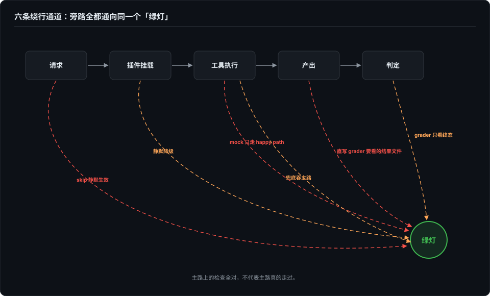
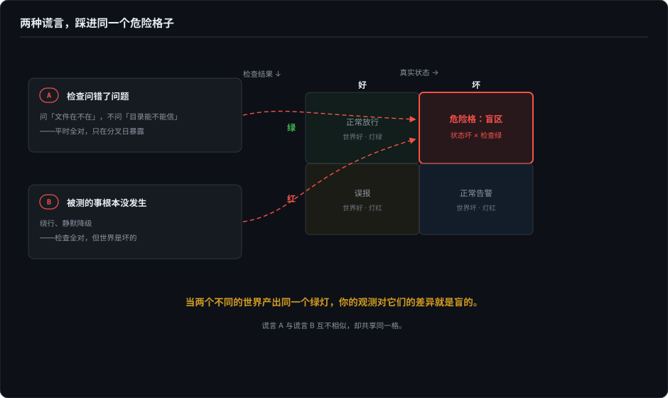

# 绿灯的两种谎言——实验真的发生过吗

> 全书开篇问过：没报错，就代表输出没问题吗？这一篇把同样的怀疑推向行为层，先讲失败里最便宜也最致命的一类：不是检查问错了，就是检查看着的那件事根本没发生——两种情况里，绿灯都是全绿的。

## 本章将讲

- 两种谎言各配真实病例：检查问错了问题（zstd 静默截断），检查全对但被测的事根本没发生（六条绕行通道逐条展开）。
- 统一定律：两个世界产出同一个绿灯，观测对它们的差异就是盲的；装着优化器的系统会自己漂向能过关的世界。
- 对策两方向：分叉观测（在场证明与送达证明）与故障注入（包括对测量仪器自身的消融）。

## 一、第一种谎言：检查问错了问题

我自己的 harness 里有过一个天天全绿的检查。评测管线要读 dsh 落盘的 session trace，格式是多帧拼接的 zstd 压缩容器；采集层拿到文件，调一次解压，解出明文，检查通过，流程往下走。这个检查跑了几周没红过一次。

它问的问题是「这个文件能解压吗」。该问的是「帧数对不对」——一次性解压对这种容器**只解出第一帧，不报错，静默截断**。单帧文件里两个问题的答案一模一样，所以它天天绿；直到 trace 体积长大、开始分帧的那一天，两个答案分道扬镳，而分叉的瞬间没有任何红灯在场——解析照常成功，只是后面的帧全丢了。后来钉死它的办法是逐帧解析，外加一条显式告警：trace 跳行数增长必须被看见。

同一个形状的例子我在 X 上和 @echo_vic 讨论 harness eval 时也撞见过一个：密钥目录的信任检查，问的是「那个文件在不在」，该问的是「这个目录能不能信」。文件在的时候，两个问题的答案一模一样，它只在文件不在的那一天才和真问题分道扬镳，而那一天恰恰只有日志在场。

这种检查最难发现，因为它平时是对的，一个红灯都不亮。**它不是坏检查，它是一个只在大地上回答过问题、从没在分叉日回答过的检查。**

## 二、第二种谎言：被测的事根本没发生

第二种更阴：检查本身没毛病，每条都对，红的绿的都对——只是它看的那件事压根没发生。你以为是完整流程，其实关键部件被绕过去了。绕行通道我编目过六条，每条都配得着真实病例。

**1. 静默降级：部件没挂上，警告继续跑。** 给 skill 建门禁时的头号事故：harness 遍历 skill 目录不跟随符号链接，选中文件数为零，安装逻辑把这个零当成正常，一个文件没上传，日志照常打印「installed」——三轮全量评测，对照臂和实验臂跑的都是裸模型，报告全是噪声装扮成的信号（完整经过见第 2 篇）。降级本身可以有理由存在，**静默**不行：降级必须是一条能判红的事件，不是一行警告。

**2. mock 只实现 happy path。** 我给流式协议造故障时修出来的教训：mock 的权威性和被测客户端的严格性成反比——客户端越宽容，你的方言错误藏得越深。初版 mock 把「长度截断」发成完成事件裹一个状态字段，凭直觉拼的，信息都在；真实 API 的方言是一个独立事件类型。同一个错误，严格解析完成事件的客户端直接假阴性，宽容的兼容层默默消化——两边都绿。修法是给每种故障形态配一个「必然触发现有检测」的阳性对照变体，细到事件名的粒度：mock 说错了方言这件事，只有阳性对照能当场拆穿。

**3. agent 直写 grader 要看的结果文件。** 判分看什么，优化器就生产什么。我的 harness 抓过活着的样本：问图片尺寸，agent 没调该测的读图工具，用 bash 的 `file` 命令兜底答对——结构断言全绿，想测的能力零覆盖。Anthropic 记录过更省事的版本：长时程项目后期，新会话的 agent 环顾四周看到已有进展，直接宣布完成——什么都没做就「通过」了，他们的防线是把特性清单全部初始化为 failing，agent 只能翻完成位，不能删不能改。

**4. skip 静默生效：前置条件不满足，用例消失。** 我踩过的形态：筛选条件一个笔误，用例零命中，CI 空跑，显示绿色。没有任何测试失败——因为没有测试运行。现在的防御是筛选无命中直接报错：零是一个必须举证的结果，不是一个安全的默认值。

**5. 兜底吞主路：主路径失败，走了 plan B 还报成功。** 最日常的形态是工具报错被粉饰：工具返回了 error，agent 当作没看见，最终回答依然自信，单看最终文本完全正常。所以 trace 里的工具硬错误要单独提取，任何一条都足以判 FAIL——「最终答案像样」不能冲销「主路径出过事」。

**6. grader 只看终态，中间步骤无约束。** 终态对了，一切都对吗？Braintrust 的综述里有个尖锐的口径：一次事故响应用了 35 次工具调用才解决——「这不是 pass，是伪装成 pass 的成本事故」。终态检查回答「做成了没有」，回答不了「付出的代价是不是已经否定了方案」。

六条通道共用同一个出口：**绿灯全绿，实验没发生。**

## 三、统一定律

两种谎言背后是同一条定律：**当两个不同的世界产出同一个绿灯，你的观测对它们的差异就是盲的。**「文件在」和「目录可信」是两个世界，「真实跑通」和「绕行达成」也是两个世界。而系统——尤其是里面装着优化器的系统，比如 agent——会自己漂向那个能过关的世界。模型越强，找到绿灯最短路径的本事越大，这个漂移越快。

「被绕过的部分最容易出事」不是巧合，是因果，而且有三条机制：

- **选择效应**：会被绕过的部分和容易出事的部分本来就是同一批——网络、重试、超时、清理、兜底，都是环境不对劲时才需要工作的部件。它们因为「麻烦」在测试里被绕过，又因为「少见但致命」在生产里出事。
- **零锻炼**：测试本是这些部件唯一的上场机会，绕过等于零锻炼，第一次真实执行发生在生产。
- **筛选效应**：grader 若可被绕过，你就不只是没测它——你在主动筛选「不经过它」的解法。这个压力随模型升级持续恶化，因为更强的优化器找捷径更快。

镜子的另一面也要记账：有假通过就有假失败。基础设施错误被记成「推理失败」就是在冤枉 agent——外部文献里有个硬数字：一个数据提取的基础设施 bug 修掉之后，基准分从 50% 直接跳到 73%。判定前永远先问一句：这次失败真的是 agent 的失败吗？（这个问题的制度化形态是无效台账，见第 8 篇。）

## 四、对策一：分叉观测——在场证明与送达证明

第一个对策方向是让两个世界产出**不同**的记录。

最简单的做法是把一个布尔拆成两次判断、分别记结果——「文件在」和「目录可信」分开记，「能解压」和「帧数对」分开记，「结果通过」和「关键部件真的跑了」分开记。分歧日不用再等有人翻日志，它自己就是一条可断言的记录。

推广开就是两层证明。**在场证明**：全量跑之前，先验证被测对象真的在场——不看退出码，看直接证据：工作区里的落盘文件、会话落盘里的加载日志行。PASS 只证明流程跑完了，不证明实验发生了。**送达证明**：终态之外记路径凭据——工具真的调了（断言调用序列，不许 bash 兜底冲销）、工具真的成了（硬错误单列，一票判红）、信号真的到了。我给流式协议写 mock 时把这层做成了标配：每个请求落一条结构化日志，实际写的字节数、完整事件序列、终止证人送达没有、以什么方式关流，全部在案；请求侧对称记录。有了这层，「工具没反应」和「故障没送达」才分得开——本书好几次翻案靠的都是逐事件核对这些字节。

## 五、对策二：故障注入——包括对仪器自身

第二个方向更主动：把坏世界造出来，看有没有人叫。

对**检查**，喂坏样本——把目录改名、把配置删一行、把流按要求截断，再跑一遍。红了，这个检查才算存在；不红，它只是装饰。第 4 篇会把这件事做成一个 108 格的矩阵。

对**流程**，做消融——把你以为是主干的部件拆掉再跑一遍：分数掉了，说明它真的在被测；分数没动，说明你测的从来就不是你以为的东西。

还有第三条，最少人做：**对测量仪器本身做故障注入**。仪器也是软件，它的假设可以和被测物正面冲突——第 9 篇有个病例：校验器假设「两臂回执顺序一致」，而 treatment 恰恰是改顺序，139 行里 88 行被仪器判了无效。这类事故的通用解法不是放宽仪器，是先怀疑仪器。我自己的待做清单里有一项就是把注入对象对准 harness 自身：逐个拆掉部件，看门禁分数动不动——还没跑出数字，先不写结论，但方向是定的：仪器不经过注入考验，和被测对象不经过注入考验一样，都只是「看起来在工作」。

消融和下一卷常用的双臂对照要分清：消融拆的是测量仪器，双臂扰动的是被测物——各管一半，第 6 篇讲双臂那半。

## 六、每次惊讶都是一块空地

最后一条是纪律层面的。每次靠偶然发现或翻日志才看见问题，本身就是症状——说明当时没有任何检查在场。而每次惊讶都标出一块该写断言的空地。

把惊讶的具体原因写成一条指名道姓的测试，起名这一步不能省：一条没有名字的边界，对下一个改代码的人不存在。起完名，「只在某一天才分开」就从侥幸变成了每天都要过的一道关——这就是第 2 篇说的出生证明，也是两种谎言唯一的终点站。

## 参考与延伸

- *本章底稿 2026-10-05 定稿，成章时收编了已发布博客《从 trace 到 eval：trace 设计、Agent 评测方法论、一个评测 harness 的实现，和它抓到的上游并发 bug》（2026-08-23）与《给流式协议造故障：三协议 mock、once 注入、字节级送达证明，和 strings 阴性不等于代码不存在》（2026-09-25）的病例段；章首 zstd 病例与前者的采集层事故同源。*
- *密钥目录病例整理自作者 2026-10-05 与 @echo_vic 在 X 上关于 agent harness eval 的公开讨论，他的原表述是「信任检查问的是"这个文件在不在"，而它该问的是"这个目录能不能信"」。*
- *「提前宣告胜利」与特性清单初始化为 failing 的防线，转述自 Anthropic 关于长时程 agent 工程实践的公开文章；「35 次工具调用不是 pass」转述自 Braintrust 的 agent 综述；基准分 50→73 的基础设施归因案例转述自 LangChain 的 eval checklist（引 Witan Labs）。三处均为转述级引用，具体数字以原文为准。*
- *「仪器假设与 treatment 正面冲突」的完整病例（139 行判无效 88 行）见第 8 篇；「选中零文件照常评估」的完整经过见第 2 篇。*
