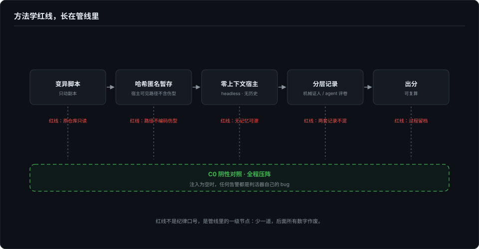
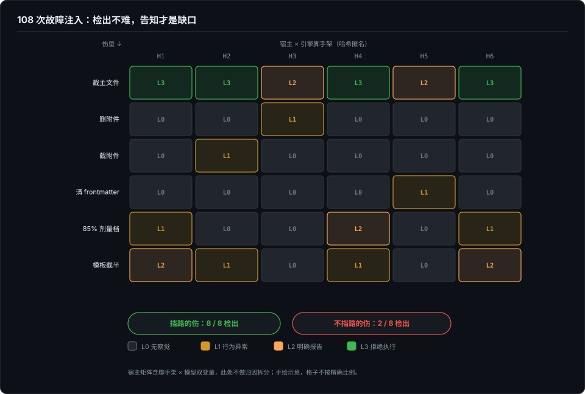

# 炸弹——故障注入下沉到内容完整性

> 协议层的 mock 解的是「环境不可控」；但还有一类更原始的故障——脚手架物理残缺：文件被截断、被删除、frontmatter 被清掉，宿主会怎样？这类「内容完整性」故障在正统 robustness eval（prompt 扰动）里是空白。这一篇是造弹与引爆的记录。

## 本章将讲

- 108 格注入矩阵：检出（L2 及以上）只有 6/30，L0 无察觉占六成——**检出不难，告知才是缺口**。
- 挡路的伤 8/8 检出，不挡路的伤 2/8——差异在位置，不在剂量。
- 方法学红线：只动副本、C0 阴性对照全程压阵，以及一个差点发布的错误结论如何被翻案。

## 一、两种炸弹

第 3 篇讲过给流式协议造故障的厨房：本地 mock provider、六种故障做成请求参数、once 注入、字节级送达证明。那颗炸弹解的是「环境不可控」——真实的断流和丢事件是运气事件，mock 里才是一行参数，确定性是全部意义。

但那颗弹炸的是「流」。还有一类更原始的故障没人埋过：**文件**。skill、插件、规则文件，全是磁盘上的一堆 markdown——它会残缺：下载截断、同步丢文件、手滑删错行、生成事故写空 frontmatter。正统的 robustness eval 折腾的是 prompt 扰动（换措辞、加噪声），「脚手架物理残缺后宿主会怎样」这一层是空白。问题很朴素：**当一个 skill 自己带着伤被加载、被执行时，宿主 agent 能发现吗？**

靶子我选了一个最疼的：阿里开源的 skill-up 评测工具链里的 skill-upper——一个「负责测评其他 skill 的 skill」。选它的理由很直白：如果连续约考官自己都带着伤出题，它改的卷子还准吗？

## 二、造弹的纪律

故障注入有一半的价值在方法学里。五条红线，每条都有出处：

1. **做实验的人不能当宿主。** 谁动的手脚谁知道伤在哪，自己跑出来的「发现」不算数。每次运行都派一个零上下文的全新宿主，只知道 skill 路径和一句普通的用户请求。
2. **中性 prompt。** 请求里没有任何「检查完整性」的暗示——「帮我给这个 skill 设计评测并 validate，别真跑」。所有运行共用同一份模板，只换路径。
3. **机械证人与 agent 警觉性分层记录。** 每个注入状态先过一个确定性检查器（frontmatter 必填字段、引用文件存活性、截断签名），它只回答「文件层面有没有伤」；然后再看 agent 层的表现。两层分开记，谁在哪一格失效一目了然。
4. **只动副本，每格必恢复。** 变异只动副本，做完即 `git checkout` 恢复，机械证人确认签名回到健康态再进下一格。
5. **C0 阴性对照全程压阵。** 全部恢复、重跑基线、期望无误报——它证明流程无残留、证人无误报。阴性对照不是走过场：没有它，「检出」和「误报」用的是同一张嘴。

后来还长了第六条，是翻车翻出来的：**宿主可见的任何路径都不能编码伤型。** 早先的运行路径里编码了伤型（`kimi+t5-trunc-asset/...`），至少两路宿主在报告里引用路径名当佐证。工具链随后把宿主可见路径全部改成哈希匿名暂存——做注入实验，连目录名都是泄密渠道。

## 三、矩阵

四种基础伤型各对应一类真实事故：T1 主文件拦腰截断在 60% 处（下载/同步截断）、T2 删掉正文明确引用的附件（拷贝丢文件）、T3 附件截到一半（半截写盘）、T4 清空 frontmatter 的 name/description（生成事故），后续又补了 T5（用例模板截半）、T6（删掉指令点名要复制的模板）和 T1-85（主文件只截 85% 的剂量变体）。行为分级：L0 无察觉 / L1 有信号但说错对象 / L2 明确指出不完整 / L3 指出并拒绝执行。

批量跑完，规律干净得刺眼：

| 伤型 | 伤与执行路径的关系 | 检出率 |
|---|---|---|
| T1 主文件截 60%（后续步骤凭空消失） | 直接挡路 | **8/8**，全部 L2，全部精确定位到断点行 |
| T6 删指令点名要复制的模板 | 指令直接落空 | 3/3 |
| T5 用例模板截半 | 半挡 | 2/3 |
| T3 参考文档截半（「可以参考」） | 不挡路 | **2/8** |

没检出的那六路不是没读文件——它们读完了半截的参考文档、用了它的决策树、给出了完整输出，只是谁也没发现文件只读到一半。**L0 的最强形态不是看不见，是看见了不认为是异常。** 定稿后还有一次场外复现：另一颗伤弹的宿主在报告里写下「SKILL.md 本身看起来完整」，而运行目录名其实已经把「带伤」泄露给它了——警觉被引导起来，又被干净的切口排除掉。

然后是回马枪，这轮我最在意。把带伤的考官（T3 版 skill-upper）留下，再给它一个被做了同样手脚的目标 skill，让它产评测用例。结果：**两处伤都没被发现，而且卷子真的改歪了**——健康基线的判分脚本对格式规则有五项显式机械断言，带伤考官产出的用例对其中源自被截半段的断言全部零命中。文档残缺 → 理解残缺 → 用例残缺，沿链静默传导，全程无告警。评测仪器的伤不治，它会继续生产出「看起来完整」的下游结论。

横向三个宿主的矩阵（各跑 T1/T3）：挡路的伤在所有宿主上稳定检出（T1 合计 14/14）；不挡路的伤出现宿主间差异（T3 从 2/8 到 3/3）。但这里必须如实声明一个口径：三列里有一列实际跑在兼容端点的另一个模型上——矩阵同时携带宿主脚手架与模型两个变量，**差异不做归因拆分**，只能写「宿主间检出行为差异可见」，不能写「谁比谁强」。原生模型对照列留在仓库的复现手册里，不重跑。

同一周我还引爆了协议层那颗弹（四个 CLI、六种流式故障、108 格）：F0 对照全绿，故障格 30 格里检出（L2 及以上）只有 6/30，L0 静默占六成；说出「回答被截断」这级人话的 L2 一格都没有——**检出不难，告知才是缺口**。两个实验一个测流、一个测文件，证据形态不同，收敛于同一句话：**内容层判不出完整性；地基只做验收，不评级。**

## 四、剂量与位置

这张表最容易被误读成剂量-响应曲线：伤越重越容易被发现。不是。T1 截 60%（丢 40% 内容）检出 8/8，截 85%（只丢 15% 的尾部速查表）反而只有 1/3——**自变量从来不是伤的大小，是伤的位置**。

准确的提法是剂量-位置效应：检出率由「伤是否横在 agent 正要执行的那条指令上」决定。指令说「复制这个模板」而文件不在，3/3；主流程的后续步骤凭空消失，8/8；「可以参考」的文档坏了一半，2/8；与本次执行无关的元数据，概率性掷骰子。为什么，留给第 5 篇——那里会把「挡路」拆成乘法里的一个因子。

## 五、翻车与翻案

这两周里我自己翻了两次车，都值得留档。

**第一次，把轶事差点写成结论。** 首轮手工实验里 T4（空 frontmatter）的宿主只字未提、照常跑完，一个干净的 L0。差点写下「执行层对元数据之伤稳定无察觉」。第三轮批量复测，三路宿主全部明确指出了空 frontmatter，其中一路还主动推断「可能影响触发」。修正后的准确说法是：那也是概率性的——**单发是轶事，x/N 才算数**。首轮那发 L0 保留为轶事证据，不计入批量口径。

**第二次，差点发布一个错误结论。** 协议层矩阵的初版里，codex 对 length 截断完全静默——这和它的源码直接冲突（源码里那个事件明确会进重试路径）。排查到最后，嫌疑人是我自己：初版 mock 把截断信号发成了完成事件裹一个状态字段，而真实 API 的方言是一个独立事件类型；客户端的完成分支根本不解析那个状态字段——**不是它收到信号装没看见，是我的 mock 压根没把信号说出口**。用法语考学生加法，学生没反应，差点判他不会算术。中途还差点二次误判：往二进制里搜事件名整串零命中，差点写下「无此处理器」——实际编译器把匹配内联成立即数比较，事件名不进字符串表，而处理器的证据串一直都在。strings 阴性，不等于代码不存在。

修正方言后全量复测，初版那两格作废，证据保留并单独标注——它们现在是「测试夹具如何制造假阴性」的教学样本。这次翻案的代价是两格子返工，不是一篇错误的结论；而它能被翻回来，全靠第 3 篇那层送达证明：「工具没反应」和「故障没送达」之间，隔着一层必须自证的字节。

两次翻车指向同一条发布纪律：**最刺眼的结论，先当嫌疑人审一遍——它往往是你自己的仪器。**

## 六、防线该长在哪

实验做完，自然的质疑是成本：检查会不会让 skill 变胖、加载变贵？答案的三档防线留到第 5 篇展开，这里只记结论的形状：把检查写进 skill 正文是最贵也最不可靠的一档（每次加载付 token，只换来看机缘的检出）；CI、loader、安装器那几档是零 token 的确定性。**完整性是供应链问题，不是上下文问题。**

## 参考与延伸

- *本章由已发布博客《回答被截断，你的 CLI 知道吗：四个工具、六种故障、108 格矩阵，和一个差点发布的错误结论》（2026-09-25）与《考官带伤阅卷：对 Agent Skill 做故障注入的完整性实验》（2026-09-27）合并收编，按「造弹 → 矩阵 → 翻车与翻案」重组；协议层 mock 的机制细节（F0–F5、once 语义）见第 3 篇与《给流式协议造故障》（2026-09-25），本章只引用。*
- *实验数字出自 truncation-detection-benchmark（2026-09-25 运行，108 格逐格证据开源）与 skill-quake（2026-09-27 前后运行，results/ 目录三批汇总）；宿主矩阵含脚手架 × 模型双变量，检出差异不做归因拆分，原生对照列见仓库 docs/REPLICATION.md。*
- *行为分级口径：L0 无察觉 / L1 信号指错对象 / L2 明确指出 / L3 拒绝执行；统计口径：首轮手工实验不并入批量累计，x/N 不读作精确比率估计（单条件 N=3～8）。*
- *上游互动：skill-up issue #253/PR #257（零文件安装）、issue #280/PR #281（完整性检查进 CLI）、kimi-code issue #4012（主 agent 截断静默接受）。*
