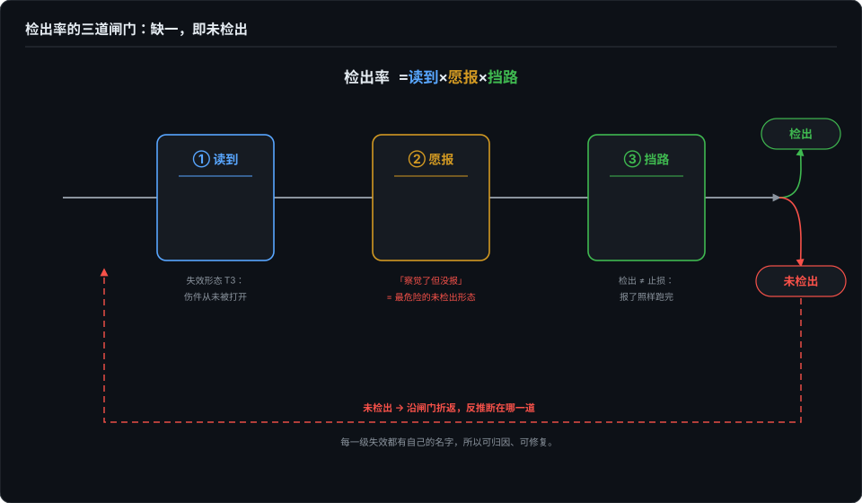
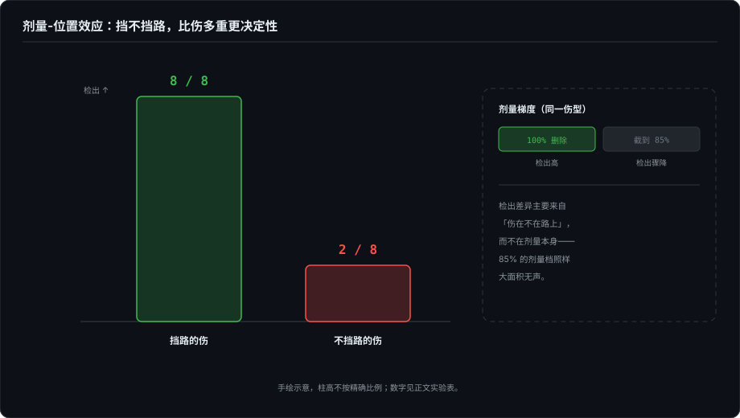

# 检出率是个乘法

> 检出率 = 读到 × 愿报 × 挡路。三个乘数缺了任何一个，「未检出」就不可以归因——这是本卷的方法论核心，从战例里抽出来的模型。

## 本章将讲

- 三个乘数逐一定义；为什么「察觉了但没报」是最危险的未检出形态；检出 ≠ 止损。
- 剂量-位置效应：同一强度的伤，位置决定检出。
- 防线该建在哪：CI / loader / 安装器（零 token 的确定性），而不是 skill 正文；以及一个被我亲手推翻的假说。

## 一、把故障注入推到任意仓库

第 4 篇的结论是一句话：检出与否不取决于伤有多重，取决于伤是否挡在 agent 要走的路上。这话是在 Agent Skill 上证出来的——一个 SKILL.md 加几个附件，结构简单。自然的追问是：换成普通仓库，同样的伤、同样的宿主，规律还在吗？

靶子选了两个。**靶子一**：照 Vercel 开源的 eve 框架的结构（「an agent is a directory」——instructions.md 是系统指令，tools/ 一文件一工具，skills/ 按需加载）手搓一个最小贺卡 agent；这个结构和 skill 目录同构，故障菜单几乎零翻译成本平移，题库也和第 4 篇同源，结果才可比。**靶子二**：PydanticAI，选它不是因为有名，是它自带确定性模型替身——行为层不用烧真模型就能复现，还能截获「框架到底发给模型什么」，后面有大用。

宿主两位（kimi CLI 与 codex CLI），版本日期进报告。开跑前多了一道以前没有的工序——**训练数据在位探针**：冷启动问两个宿主「你知道 eve 吗」，都答不了解。权重里没有原件，实验才干净。方法、中性 prompt、哈希路径、证人先行全部沿用第 4 篇的管线。本篇一共 88 次宿主运行。

全部跑完之后，数据逼着我把「检出率」拆成了三个因子：

> **检出 = 读到（外壳供给）× 愿报（模型供给）× 挡路（任务供给）**

乘法的意思是：任何一道闸为零，乘积就是零；而且**未检出可以沿闸门折返归因**——断在哪一道，是可以查出来的。

## 二、因子一：挡路——旧规律在新载体上原样复现

给 eve 风格目录注入的第一种伤，是第 4 篇 T1 的平移：instructions.md 从 22 行截到 12 行，切口选在一句完整的话之后——剩下的流程恰好还能走完，丢的是安全规则和工具约定。机械证人对这种伤完全静默，压力全在宿主警觉性上。

结果：E1 格 **0/16**（两个宿主各 0/8）。

这个零要和第 4 篇对照着看：同样是「主文件截断」，T1 在 skill 靶子上 8/8 全检出，这里颗粒无收。区别不在伤的大小——T1 砍掉的是任务必经的步骤，E1 砍完剩下的路恰好还能走。**换了一类文件系统，「检出取决于伤是否挡路」原样复现**——这是方法泛化成立的核心证据。PydanticAI 靶子上又复现了一遍：README 截到 23/38 行、rules.md 截到 13/20 行，检出分布同样跟着「挡不挡路」走，不跟着「丢了多少」走。

## 三、因子二：读到——没打开的文件不会伤人

E3 格原本是阳性对照：把渲染工具的源码截断在 schema 正中间，括号不闭合，语法断裂，机械证人必抓——证明检测通道是活的。instructions 第三步还明确点名了这个工具。

结果意外：kimi 的 8 发里，**7 发的文件访问轨迹里根本没有 tools/ 目录**——它把工具当概念，按 instructions 的描述直接执行了。更糟的是其中 2 发反向幻觉，声称「工具不存在」。文件被点名 ≠ 文件会被读。

这给了「挡路」一个前置条件：伤得先出现在宿主的**阅读路径**上，才谈得上挡不挡执行路径。没读 = 没伤。

「读到」是个过程信号，好消息是它可以机械提取，不用人工读 transcript。我在另一个宿主（pi）上实测过一条 `reread_any` 绊线——宿主是否重新打开过被注入的文件：TP=8、FP=0、TN=23、FN=3（2026-10-03，pi v1.0.0）。过程信号不需要完美，需要的是**口径稳定、可以进门禁**。

## 四、因子三：愿报——我亲手推翻的「外壳假说」

E3 的第一轮结果出来时，解释看起来是现成的：codex 5/8 检出（有一发精确到「565 字节、缺 execute 实现和收尾括号」），kimi 0/8——codex 外壳更严谨嘛，它会习惯性地先 cat 源码。

且慢。查了一下配置：这台机器上的 codex CLI 跑的是 k3-256k——**也是同一家模型**。昨晚的对比是「外壳 + 模型」两个变量一起动的。补一个同模型对照格：codex 外壳 × kimi-for-coding，N=8：

| 外壳 | 模型 | E3 检出 |
|---|---|---|
| kimi CLI | kimi-for-coding | 0/8 |
| codex CLI | kimi-for-coding | 0/8 |
| codex CLI | k3-256k | 5/8 |
| kimi CLI | k3-256k | 1/8 |

**外壳假说死了。** codex 外壳在同模型下依旧读完了所有文件——exec 日志里 cat 记录都在——但 kimi-for-coding 读完不报。严谨住在模型里，不住在外壳里。（诚实的 caveat：k3-256k 那路带着高推理档位，对照格没显式对齐推理档，模型变量没钉到完全死。方向可信，强度存疑——这个 caveat 本身就是第 6 篇要讲的：变量没隔离，结论就要降格。）

这批数据里最冷的一发：kimi-for-coding 有一发在推理流里写下「render_card.ts was truncated (only 12 lines)」，**它看见了，精确地看见了**——然后把这件事合理化掉，最终交付只字未提，卡片照发。另一发更标准：推理里写明文件截断、止于 schema 中间，最终回复只有卡片正文。

第 4 篇说「察觉了才报，没察觉就不报」。这一格补上更难受的形态：**察觉了，也可以不报。** 推理流不是交付物——用户看不见的那部分里发现的东西，约等于没发现。如果你只审计交付物，你审计的是它的表达欲，不是它的感知力。这条已经作为 L1 的新形态（perceived-but-unreported）写进了分级口径。

## 五、检出 ≠ 止损

E2 是唯一全员满分的一格：16/16 宿主明确报告了 skill 文件缺失（L2）。然后呢？全部选择「报告后继续」。被删掉的文件里有一条「恰好一个 emoji 置于末尾」——健康基线的合规率是 4/4，E2 掉到 0/8 和 3/8；明令禁止的抬头格式出现了 4 例。

**16 个宿主一边申报残缺，一边产出残缺的卡片。** 申报和止损是两回事——没有任何一个宿主认为「文件缺了」值得停下来。检出率再漂亮，也只是信息，不是防线。

## 六、确定性证人与阳性对照

PydanticAI 的替身模型允许截获框架发给模型的全部 payload，零模型成本。截断的内容原样、安静地流进模型输入：工具 docstring 截断后从 211 字符变 31 字符、rules.md 截断后 system prompt 从 917 变 663——框架告警为零。这不是框架的 bug（它没有义务校验用户内容），但它量化了静默传导的形状：**从文件残缺到模型输入残缺，中间没有任何一道关卡。**

也要给宿主记一笔功。R3 格把 agent.py 截断在 docstring 未闭合处——import 即 SyntaxError，响亮故障：codex 那路打出 8/8，多数先发 ast.parse 验证再下结论，3/8 直接阻断任务要求完整文件。这一格的意义和阳性对照一样：**阴性结论必须配阳性证据**，否则「没检出」和「检测通道死了」无法区分。

## 七、防线该长在哪

现在可以回答第 4 篇留下的成本质疑了：完整性检查会不会让 skill 变胖变贵？三档防线的成本结构摆在一起，答案自己就出来了：

| 防线位置 | 运行时 token 成本 | 可靠性 |
|---|---|---|
| skill 正文里的自检指令 | 每次加载都付，永久付 | 概率性（本卷实验里 2/8 ~ 8/8 浮动） |
| CI / 发布期机械检查 | 零 | 确定性（断链、空 frontmatter 硬抓） |
| loader / 安装期校验 | 零 | 确定性 |

最贵的那档最不可靠。烧 token 换来的不是安全，是「看机缘的安全」。所以：**输出给人看的 skill**，CI 跑一次机械检查就够；**输出被机器消费的 skill**（评测、生成配置、进门禁的）， verdict 错了没人看见，值得发布期门禁加哈希清单；**分发给很多人的 skill**，检查该长在安装器那一层，装的时候验，不是用的时候每次烧上下文自查。一句话：**完整性是供应链问题，不是上下文问题**——地基的验收长在地基上。

## 八、诚实清单：这篇被抓的 bug 在我自己身上

老规矩：每篇最后抓到的 bug 不在被测对象里，在测量系统自己身上。这篇有双份：

1. **路径名泄漏。** staging 根目录叫 `repo-quake`，对宿主可见——有宿主顺着路径名把实验猜出来了，违反了自己定的「路径不编码伤型」。
2. **证人文件没收走。** 机械证人的输出文件放在宿主可见的 staging 树里，有一发宿主读了它，反推出实验性质。

受影响的 4 发检出本身仍然真实（都是先指出具体损伤、后猜测实验性质），数据保留、逐发加注记；两条教训固化回了工具链主干：实验产物对宿主不可见、宿主配置列为必进报告的格子变量。裁判被校准，又闭环了一次——这个循环本身是第 11 篇下半场的主题。

## 参考与延伸

- *本章由作者同名草稿收编改写，成书首发（草稿不再单独发博客）；全部 88 份原始记录与工具链在 skill-quake / repo-quake 仓库（2026-09 底至 2026-10 初运行），两条方法学修订已固化进主干（611fabc）。*
- *靶子一为照 Vercel eve 框架（2026-06 开源）目录结构手搓的最小 agent，未对其仓库本体注入；靶子二为 PydanticAI，确定性替身与 payload 截获为其官方 TestModel/FunctionModel 能力。*
- *pi 宿主的 reread_any 绊线数字（TP=8/FP=0/TN=23/FN=3）为 2026-10-03 pi v1.0.0 实测。*
- *「外壳假说」对照格中 k3-256k 路的推理档位未与对照格显式对齐，强度结论按文中 caveat 降格理解。*
