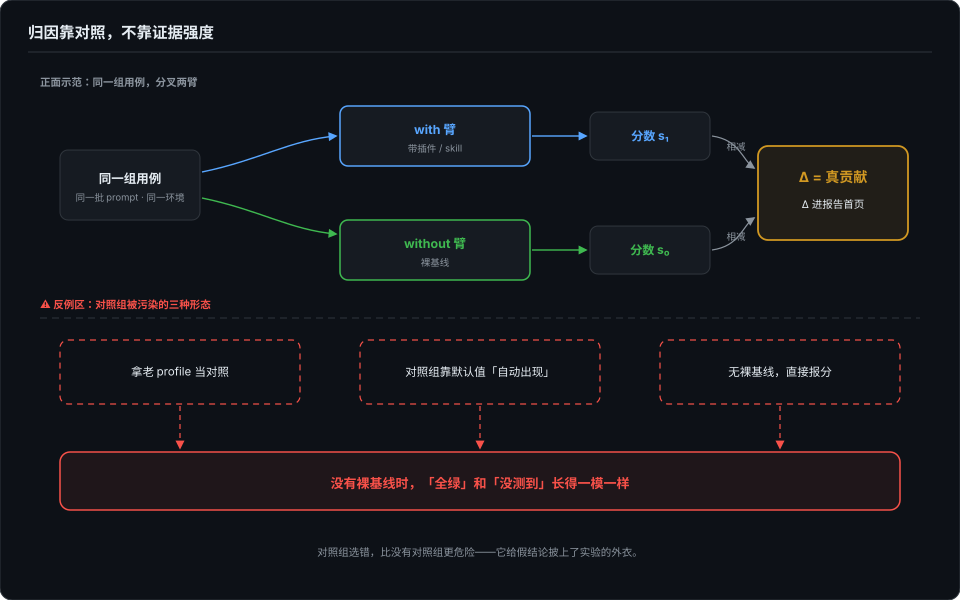
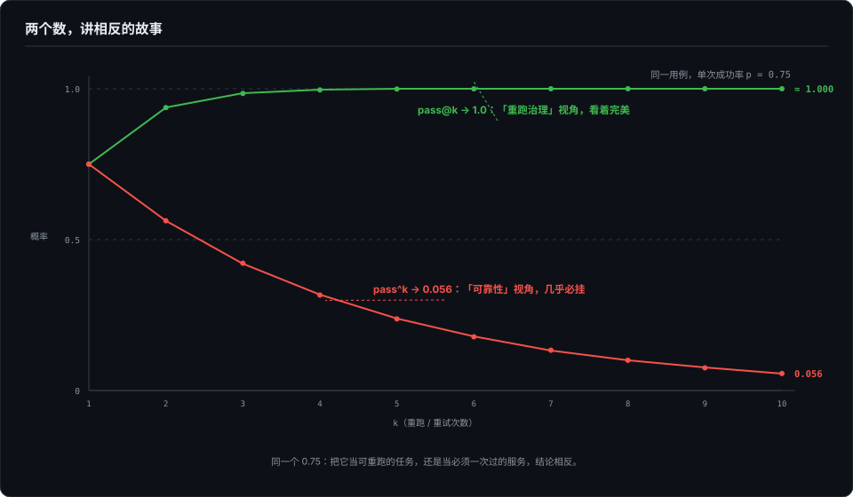

# 对照组的陷阱——归因靠对照不靠证据强度

> 证据再硬，也同时兼容两个相反的故事。对照组选错比没有对照组更危险——它给错误结论配上证据。这一篇讲归因的最低配置。

## 本章将讲

- 双臂对照（with / without）为什么是归因的最低配置；裸基线缺位时，「全绿」和「没测到」同貌。
- 对照组被污染的三种形态。
- pass@k 与 pass^k：同一个 0.75，两个数讲出相反的故事——单次跑分为什么不作数。

## 一、测自己的东西有 spec，测别人的没有

前面几篇的靶子都是自己的东西：自己的插件、自己的 skill、自己用的 CLI。这一篇换猎场——测别人的生态。靶子是 dsh 插件榜上三个高星项目：一个路由/注入器（约 7000★）、一个视觉工具（约 4000★）、一个多 agent 编排（约 1800★）。星数是测评当天从 GitHub API 现拉的，版本和日期先进报告，老规矩。

测别人的东西，差别只有一句话：**测自己的工具有 spec，测别人的生态没有。** 你不知道作者的设计意图，只有一份 README、一个安装命令、和一堆你愿意相信的星。oracle（判定依据）的缺席逼出三个新问题：oracle 从哪来？锅（失败的归因）怎么分？分母（结论对什么成立）是谁？插件的测评结果只是证据，主角是方法。

## 二、分母是谁：你只能测装得上的

先说一个容易被跳过的前提：生态评测的分母从来不是「全部插件」。最大的插件目录收录约一千五百条，收录规则是提个 YAML 就进——没有安装验证。另一份清单的作者较真，在容器里逐个真装：9247 个候选，1673 个实测，**979 可用 / 600 不兼容 / 94 待定**——装得上的只有六成。任何生态测评的结论，天然只对「可安装的头部」成立。

这一层很快就从「前提」变成了「数据」。第一个插件就给我上了一课：7000★ 的那个，一键安装命令成功、exit 0，插件是死的——它靠 `prepare` 钩子在安装时自动构建，而隔离环境的包管理器默认拦截构建脚本，产物目录整个缺席。**安装命令的成功和插件的存活是两个独立事件。** 顺手还抓到 npm 同名错位：裸名指向的是另一个账号的不相干包，而真身其实挂在 scoped 名下——安装指引的正确形态只剩一种：全限定、钉版本、写明出处。

所以漏斗有四层：**人气 → 可装 → 行为正确 → 故障韧性**。安装不是测评开始前的静默过滤器，它就是第一层数据。

## 三、oracle 从哪来：三种，加一张诚实牌

没有 spec，oracle 只有三个来源，抓的虫不同：

- **README 承诺**——测名不副实。把作者宣称的功能落成可判定断言：它说「图片给它，还你结构化证据」，那就断言它的工具必须真实被调用、输出必须带工具标记（不许 bash 兜底答对——第 3 篇的覆盖断言在这里复用）。
- **行为钉版**——测回归。把首次运行的行为固化为基线，将来变了就红。措辞要小心：行为变了不等于行为错了，红只意味着「该有人来看一眼」。
- **宿主不变量**——测相容性。「插件在场时，宿主原有的故障处理不能被破坏」——最有杀伤力的断言，因为它不依赖插件的任何文档。

三个插件恰好各占一种形态。但第四种情况也存在：**有些承诺落成不了可判定断言。** 视觉插件的「看图看得好不好」，在我的环境里没有能用的视觉引擎，无法判定。正确动作是在报告里如实标「不可判定」——写一条永远通过的橡皮图章断言假装覆盖到了，比没有断言更坏：它给「没测」配了证据。

## 四、双臂：归因的最低配置

韧性层的做法是 chaos：把插件挂进故障环境跑四格（对照 + 三种协议故障）。判定口径一句话：**挂载后宿主行为变了，账才算到插件头上。** 两个可测插件全绿，与裸基线逐格一致。

这个「全绿」值钱，值钱在它是对照出来的：一个直接坐在模型请求链路上的 7000★ 注入器插件，不破坏宿主的故障检出与恢复——**没有裸基线，「全绿」和「没测到」长得一模一样。** 这就是双臂对照（with / without）的最低配置地位：两臂只差一个变量，分数相减得 Δ，Δ 才是被测物的真贡献。

这个设计不是私家偏方。Anthropic 官方的 Claude Code plugin evals 把 with/without 双臂默认打开、裸基线内置——「插件在不在场」作为一等变量写进了官方评测协议（其 grader 分六档，机制不展开，一句官方背书即可）。社区基建和官方文档在同一个点上汇合：双臂不是增强，是底线。

对照组的反面教材有三种常见形态，都进过我的事故现场：拿**老配置**当对照（混淆变量藏在「新旧差异」里，下一节的翻案就是它）；对照组靠**默认值**「自动出现」（第 2 篇里宿主的自动发现机制把对照组悄悄喂了和能力同源的东西——对照组的「无」必须强制出来）；以及干脆**无裸基线**直接报分。三种形态殊途同归：给错误的结论配上了证据。

## 五、一次推翻自己的归因

本篇的戏肉，是我自己的一次误判。

视觉插件的行为层首跑，现象非常「清楚」：在新建的隔离配置里装上插件，首次启动直接挂死，三十分钟没有输出。安装日志干净、配置结构正常、插件是 npm 正规军——「插件启动阻塞」，归因报告第一版就这么写的，证据看着很硬。

按归因纪律，下结论前补一个裸对照：全新配置，什么都不装，首启。

也挂。

真凶是宿主自己的「新配置首启挂起」——和插件无关。我当时的对照用的是老配置，混淆变量是「新配置首启」而不是插件。**对照组选错比没有对照组更危险**：没有对照，你只会说「我不知道」；有了错的对照，你会说「我知道了」——而那个知道是错的。

后续按纪律执行：归因文件里 v1 的错误结论和推翻过程**原样保留**，没有改成「一开始就判对了」——归因文件的价值恰恰在于记录错误，下次再遇到「证据很硬」的时刻，它提醒你硬证据是怎么兼容两个故事的。宿主的真 bug 报了上游（复现步骤与四路排除证据附全）；插件这边我只提了 issue 没提 PR——提 PR 得拿出能跑的方案，提 issue 只要附上能复现的证据，前者是空头承诺，后者才是诚实可行动。

这轮还顺手校准了裁判自己：评测 runner 的超时只杀直接子进程，包装器形态的孙进程被孤儿化，整条 runner 挂死 34 分钟——裁判被它要测的场景打穿了。修复是进程组杀，回归测试专门断言「孙进程必死」。这个故事的完整版归第 10 篇。

## 六、pass@k 与 pass^k：单次跑分不作数

最后一节是统计口径，不堆公式，只讲两个数讲出的相反故事。

一个 agent 单次成功率 0.75。现在跑 10 次。**pass@k** 问：10 次里至少成功一次的概率——约 1.0，近乎必然。**pass^k** 问：10 次全部成功的概率——0.75¹⁰ ≈ 0.056，几乎不可能。同一个 0.75，一个讲「给它机会总能成」，一个讲「交给它必出事」。两个数都对，但一个是给消费者看的广告，一个是给运维看的账单。

选哪个数取决于你回答什么问题：「这个 agent 有没有可能做对」用 pass@k，「这个 agent 靠不靠得住」用 pass^k——τ-bench 把后者立为可靠性指标，理由就是它对「时灵时不灵」的惩罚是指数级的。混在一起用就是叙事作弊：拿 pass@10 的 1.0 去汇报可靠性，等于把十次里的九次失败从分母里抹掉。

所以第 2 篇那个现象（同一条用例三轮跑出 25%、75%、100%）的读法就清楚了：单次跑分是采样，不是测量。配套纪律两条：报告必须带迭代次数，单比例用 Wilson 区间看下界不看点估计——点估计的 3/3 和 30/30 在报告里长得一样，区间不会撒谎。

## 七、沉淀：生态评测四条

1. **分母写出来。** 采样框、安装成功率、剔除名单全进报告；结论只对「可安装的头部」成立，这个限定写进结论本身。
2. **oracle 分三层。** README 承诺 / 行为钉版 / 宿主不变量；写不出可判定断言的，标「不可判定」。
3. **归因先跑裸对照。** 红格没有对照组不许下结论。
4. **成本透明。** 版本、日期、token 开销进每份报告（本轮真实 API 合计 20116 token）——读者有权知道结论的价格。

## 参考与延伸

- *本章由作者草稿《测别人的生态：四层漏斗、三种 oracle、一次推翻自己的归因，和它抓到的三只 bug》收编改写，成书首发（草稿不再单独发博客）；实验运行于 2026-09-26/27，上游互动：dsh Discussion #7978（新 profile 首启挂起）、routing-suite issue #152（预构建产物建议）。*
- *Anthropic Claude Code plugin evals 的双臂默认开启与六档 grader，经官方文档核实（2026-10-05，v2.1.269 文档口径）。*
- *pass^k 可靠性指标与「看数据库终态」的判定方式出自 τ-bench 论文；可安装率数字（9247/1673/979/600/94）来自社区清单作者的容器实测，引用时已注明口径。*
- *消融与双臂的分工：消融拆测量仪器（第 3 篇），双臂扰动被测物（本篇），各管一半。*
