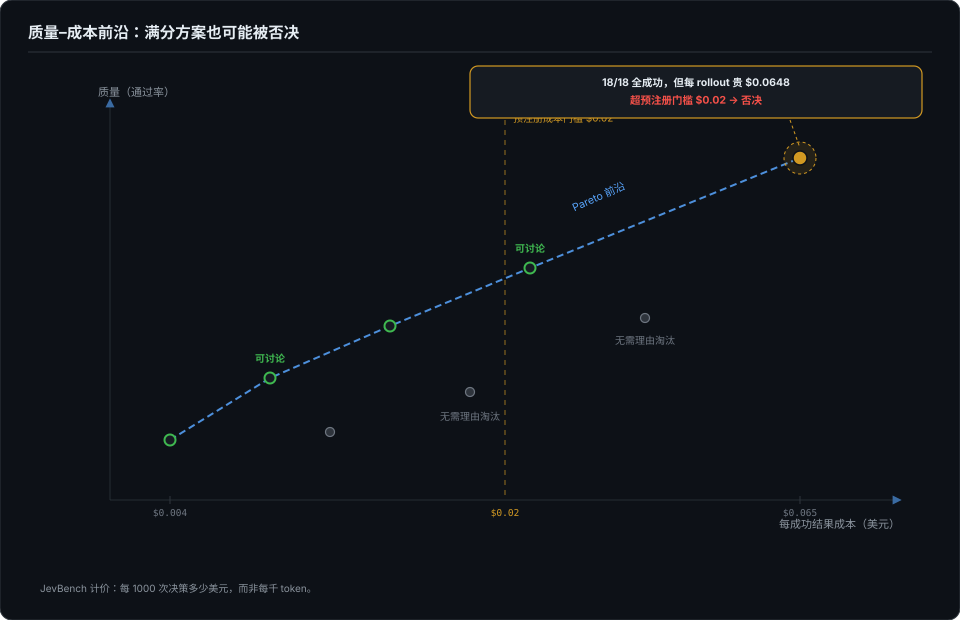
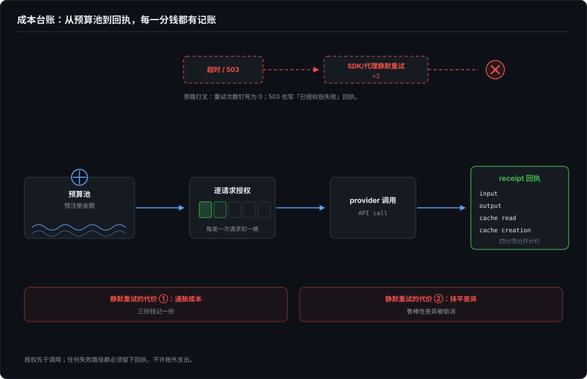
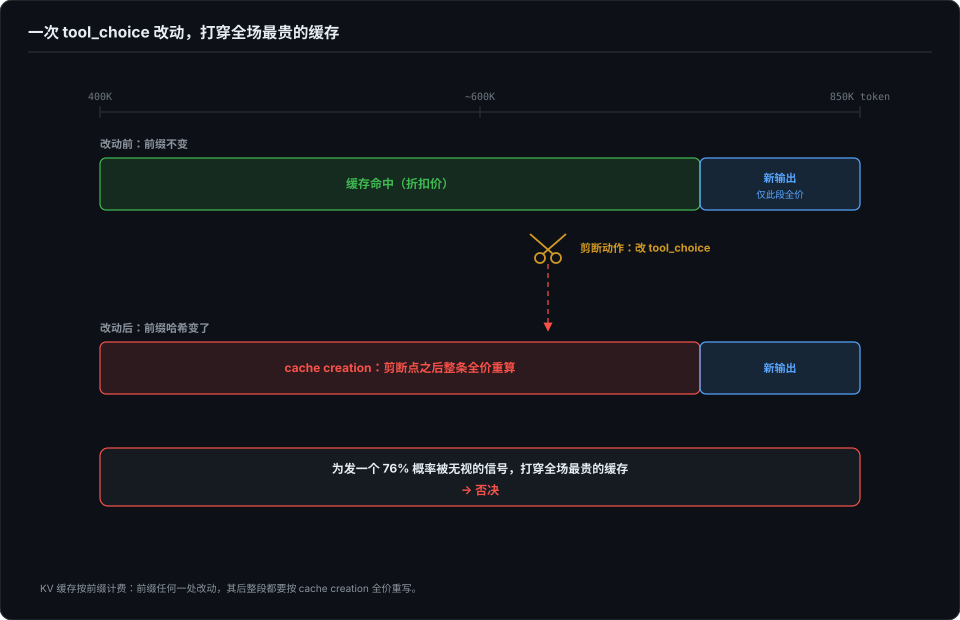

# 什么代价——质量与成本的联合裁决

> 第 1 篇的四问里，「什么代价」一直只有一句话：成本是一等约束。这一篇把这句话展开——不是讲怎么省钱，是讲**成本怎么进入 go/no-go 决策，以及成本账怎么记才不污染归因**。

## 本章将讲

- 只按质量裁决等于给「花钱买通过率」开后门：四条明码标价的通道。
- 裁决的三个量：cost per success、边际成本、质量-成本前沿拐点。
- 成本首先是实验卫生问题：零静默重试、缓存经济学、两臂计费路径逐字节对齐、美元门槛预注册。

## 一、开场：十八比十八，为什么仍然被否决

先交代我自己的一笔糊涂账。第 4 篇那个截断检出矩阵，每格跑三次，108 格格格都是真金白银的会话；给 skill 建门禁时为了把置信区间压窄，采样模式一开就是好几轮。这些钱当时花得都对——但「花得对」的判断从来没被写进任何裁决规则，全靠手感。我的 harness 记了每一个 token 的去向，却从没回答过一个问题：**这个通过率是多少钱买的？**

然后我读到了一个把这个问题回答到底的裁决。我持续在看的一个开源 agent 内核项目（单人维护；为保持小册独立叫它 M 项目，出处登记在写作简报里），它的评测台账里有一次配对实验：对照组和实验组各 18 个 rollout，**两组 18/18 全成功**。质量打平，实验组还多一套机制。按「通过率说话」的习惯，这个实验该判实验组赢。裁决却是**拒绝**——实验组每个 rollout 多花 0.0648 美元，而实验合同里预注册的成本门槛是 0.02 美元。

两组全成功，仍然被否决。我第一次读到时停了一下：它逼出的正是我一直在回避的事——**只按质量裁决，等于给「花钱买通过率」开后门。**

## 二、通过率是可以花钱买的

这不是比喻，至少有四条明码标价的通道：

1. **换更强的模型**。同一个 harness、同一批题，模型升一档，分数涨一截，单价也涨一截。
2. **重试**。偶发失败重跑，pass@k 随 k 爬向 1.0——第 6 篇讲过，这是把「跑多次」从测量手段偷换成提分手段。
3. **堆上下文**。更多规则文件、更多历史、更多 few-shot，弱模型也能被上下文抬着走。
4. **加密自检**。改完让模型自查一遍、再跑一轮 judge 复核，失败率会降，token 翻倍。

这四条通道有个共同特征：**在只报通过率的报告里，它们全部隐身。**一个 80% 通过率但平均花 2 美元的臂，和一个 78% 通过率花 0.2 美元的臂，在 pass rate 排行榜上前者赢；在真实产品里，后者可能是唯一能上线的那个。没有成本轴的通过率是单目视觉：看得见高低，看不见远近。

## 三、裁决的三个量

把成本放进裁决，需要三个量，而不是一个总价。

**每个成功结果的成本（cost per successful outcome）。** 分母是成功数，不是运行数。一个臂跑 100 次成 50 次花 100 美元（2.0 美元/成功），另一个跑 100 次成 40 次花 20 美元（0.5 美元/成功）——后者用四分之一的价格买到一个成功，只低 10 个百分点。预算受限的真实运营里，这是四倍的覆盖差距。

**边际成本：下一个百分点多少钱。** 从 60% 买到 70% 可能每个百分点 5 美元，从 85% 到 86% 可能 50 美元。决策不是「要不要更强的方案」，是「我现在在曲线的哪一段」。

**质量-成本 Pareto 前沿。** 每个方案画成散点，前沿上的方案才有资格被讨论，前沿内侧的方案不需要理由就淘汰。M 项目那个 18/18 的臂被否，不是因为它差，是它落在前沿内侧：同样的质量，对照组更便宜。

一个公开的参照系：第三方榜单 JevBench 把 Cost 与 Intelligence、Calibration、Speed 做成等权几何平均的四个轴，成本按「每 1000 次决策多少美元」计价——不是每千 token。计价单位的选择有深意：token 是模型厂商的计费单位，决策才是用户的消费单位。用户要的是「这个 agent 每做一次判断我付多少钱」，不是「它吐了多少字」。（界面部分第 8 篇讲过 usage 字段是滞后值、界面上怎么显示；这一篇管的是账本，不管显示。）

## 四、成本首先是实验卫生问题

读到这里容易以为成本是经济话题。不是。在评测里，**成本首先是归因问题**：两臂的计费路径不一致时，效果差和成本差同时无法归因。

### 零静默重试

最隐蔽的成本失真是静默重试。请求超时，SDK 默认帮你重试两次；provider 返回 503，代理层悄悄换个节点再发。账面上你看到的是「这次成功了、花了这些 token」，实际买到的是「三次尝试里有一次成功」——而对照组可能没有同样的重试配置，只试了一次。

M 项目的付费 runner 直接把这个口子焊死：自动重试次数钉死为零，每次请求单独授权，撞上 503 也写一条「已授权但失败」回执，永不自动重试。理由有两层：重试既**通胀成本**（一个样本实际花了三份钱记一份），又**抹平差异**（鲁棒性本来就是两臂差异之一，重试把它偷偷消掉了）。

我在自己的 harness 里踩过它的镜像面：失败重跑会被上一次尝试的残留文件污染，甚至残留 git history 能被 agent 翻出来获利（第 3 篇）。**重试污染的从来不只是状态，还有账本。**

### 缓存是长上下文实验最大的隐性变量

第二个失真源是 prompt cache。长上下文会话里，前缀的几万 token 走缓存命中和走全价，成本差一个数量级。这制造了一种很难察觉的耦合：**你对干预的任何改动，都可能顺手打穿缓存。**

M 项目在设计停滞熔断时否掉过一个方案——「检测到空转就限制下一轮的 tool_choice」——否掉的理由里有一条纯经济学的：改 tool_choice 会让 provider 侧的消息缓存失效，在 400K–850K 上下文的场景里，那是全场最贵的一次 cache miss，而这个方案只是为了发一个模型大概率无视的信号（其自家长上下文实验里，76% 的文本型进度提醒被模型无视——第 10 篇汇总过这类干预的失效证据）。**一次干预的成本不只是它自己的 token，还有它顺手作废的那截缓存。**

记账时 usage 必须分项：input、output、cache read、cache creation，只报一个 total 等于瞒账。口径还要和漂移检测分开：我的 trace 提取层为门禁定的总量口径排除缓存命中（那是为漂移检测服务的）；算成本账时反过来，缓存读按折扣价如实计入。两个口径各管各的，混用就是假账。

## 五、两臂的计费路径必须逐字节对齐

配对纪律（第 9 篇展开）在成本侧有一个值得单独点破的应用：**两臂除 treatment 外，计费路径必须一致。** 同一个模型版本、同样的温度采样、同样的重试策略（最稳妥是两臂都零重试）、同样的缓存条件（前缀一样长、内容一样，否则 cache miss 率的差异会被误记成 treatment 的成本效应）。

最容易漏的是默认功能开关。M 项目的记忆实验出过一个真实事故：对照组忘了关默认开启的内置判官，结果对照组悄悄用上了和实验组同源的能力，A/B 直接报废。他们的修法值得抄：评测环境每一步默认把判官接入地址导出为关闭态，需要的臂再显式换回。**默认值永远站在污染那一边，对照组的「无」必须是强制出来的**——第 6 篇立过这条原则，成本记账是它的又一个适用面。

## 六、美元门槛要在花钱之前写死

最后一块拼图：预算和停止规则必须**预注册**——看到任何数据之前写进实验合同。至少五个字段：累计授权金额（花完即停，不许边跑边追加）；单样本成本上限；超支样本的归属（记 invalid 还是计入分母，二选一事前定）；成本门槛（每成功结果多少钱以内算「不更贵」）；到达预算后的动作（停止并按已有数据判，还是挂起等下次授权）。

M 项目的记忆排序试点合同里，累计授权就是 15 美元、shard 顺序执行；开场那个 0.02 美元门槛也是实验开始前写死的——所以 18/18 打平时裁决毫无尴尬：**规则先于结果，执行规则不需要勇气。**这套纪律和第 7 篇的预注册停止规则是一体两面：停止规则防「偷看数据决定要不要继续跑」，美元门槛防「效果不显著就加钱硬买」。事后追加的预算和事后追加的样本一样，都会把探索性分析伪装成确认性结论。

## 七、四问的闭环

第 1 篇的四问到此全部有主：能不能做对（第 2–5 篇）、坏了会不会察觉（第 3–5 篇）、是不是它的功劳（第 6、9 篇）、什么代价（本篇）。

刻意留一条缝：本篇讲的是裁决与记账——钱花了多少、买到了什么、该不该继续花。但「花掉的上下文有多少真正有效」是另一个问题：800K 上下文里模型认真在读的可能只有一小段，有效窗口随长度衰减。那条线是价格之外的质量问题，两个账本分开记；它暂列未来选题、不占编号，等实验数据齐了再独立成章。

*本章外部病例来自我持续在看的一个单人维护开源 agent 内核项目的公开评测文档与变更记录（观察窗口 2026-10 上半月，含其评测规范、停滞熔断设计文档与记忆试点合同；项目名从略，链接与原文出处登记在写作简报，成书前由我凭链接复核全部数字）；JevBench 为独立的第三方公开榜单（其四轴计价口径见其公开 METHOD 文档）。自家病例出自 dsh-eval-harness 与截断检出矩阵（2026-09）。*
