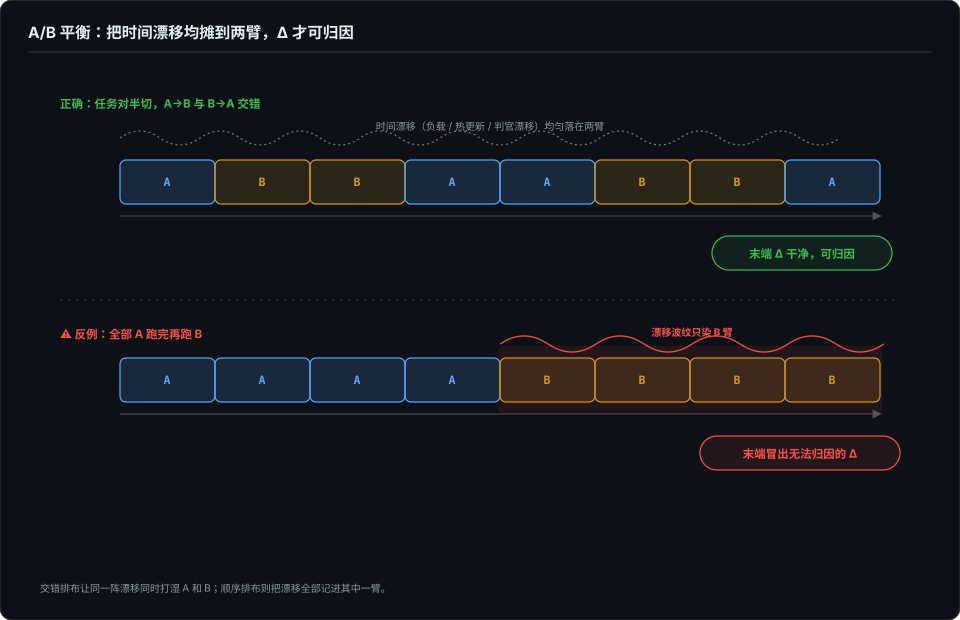
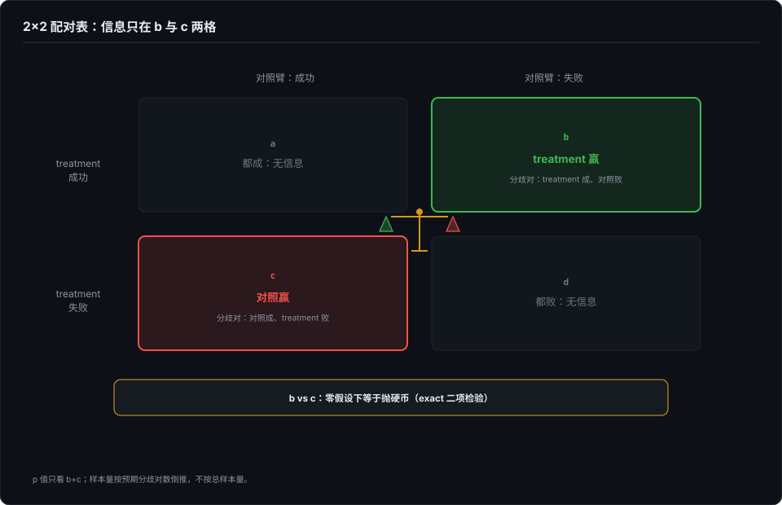
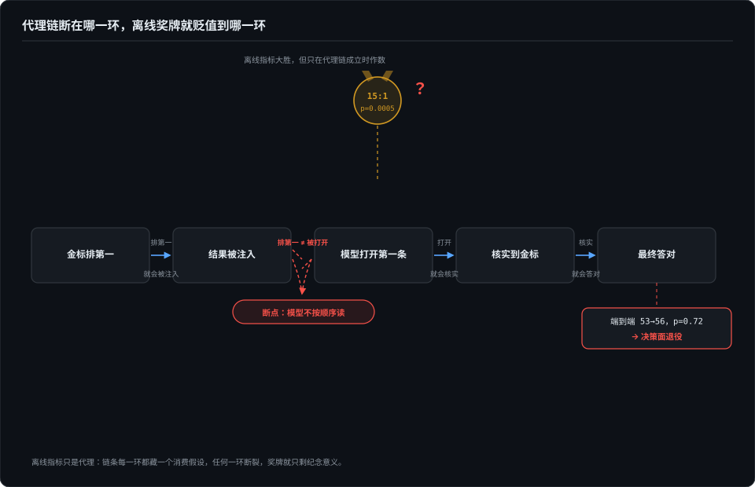

# 配对实验手册——让同一道题回答两次

> 第 6 篇回答了「为什么必须对照」，这一篇回答「具体怎么跑」——从 fixture 冻结、顺序平衡、分歧对统计，到无效台账和预注册合同。目标是工具性的：读完能照着开出一次配对实验。

## 本章将讲

- 为什么独立两组经常不够用；配对 = 每个任务自己跟自己比。
- 信息只在分歧对里：2×2 表的 a/d 不提供信息；样本量按预期分歧对倒推。
- 无效永远不是失败；规则先于数据的预注册合同；代理指标的消费假设。

## 一、为什么独立两组经常不够用

agent 任务有两个讨厌的性质。

**任务难度高度异质。** 一批 30 道题里，5 道闭着眼都过、5 道神仙难救，真正区分方案的是中间 20 道。独立两组各跑一批，组间差异里混着「题不一样难」的噪声，样本量被任务方差吃掉一大半。

**单次行为是概率化的。** 同一道题同一个模型跑三遍，25%、75%、100% 都出现过（第 2 篇的实测）；judge 的心情也在抖。两个概率化的东西相减，噪声先进分子。

配对设计的想法只有一句话：**让每个任务自己跟自己比。** 同一道题、同一个模型版本，只改 treatment，跑两次——一次开、一次关。两次结果的差，把任务难度这个最大的噪声项从分母里消掉了。医学上同卵双胞胎对照干的就是这件事，区别只是我们的「双胞胎」是同一道冻结的题。

## 二、配对实验的最小结构

一次站得住的配对实验，五个部件缺一不可。

**1. fixture 冻结。** 题面、被测仓库 commit、scorer 版本全部钉死。题在两臂之间不许有一个字的差别——连换行都不行，换行就是 prompt 差异。我的 dsh harness 用 overlay 注入会话落盘根而不是环境变量，原因之一就是环境变量会泄漏进工具调用，变成两臂之外的第三个变量。

**2. 每臂全新隔离环境。** HOME、工作区、记忆库、落盘根全部 per 臂重建，跨臂零泄漏。第 3 篇的重跑卫生在这里全部适用：残留文件让假通过有地方生长，残留的 git history 能被 agent 翻出来获利，残留的长期记忆更狠——它让两臂共享了一个你没在设计里声明的「第三臂」（记忆类实验的完整污染清单见第 10 篇）。

**3. 顺序平衡（AB/BA）。** 一半任务先跑 treatment 再跑对照，另一半反过来。不做平衡，时间会冒充 treatment：provider 负载随时段波动、模型可能在实验期间被热更新、判官服务自己也在漂移。我做截断矩阵时坚持每格三跑而不是一锤定音（第 4 篇），处理的是同一类时间风险；配对设计把它从「多跑几次平均」升级成显式的交叉表。



**4. 确定性参数写明，不确定的也写明。** 温度、top-p、seed 能固定就固定；固定不了的（平台不给 seed），在报告里如实写「此项不可复现」。把不可复现项藏起来，配对就退化成披着配对外衣的独立两组。

**5. 唯一主指标。** 一次配对实验只允许一个主指标。次要指标可以记十个，但 go/no-go 只看预注册的那一个——否则等于十张彩票里挑中奖号码，统计检验全部白做。

## 三、信息只在分歧对里

配对结果画成 2×2 表：

|  | 对照成功 | 对照失败 |
|---|---|---|
| **treatment 成功** | a（都成） | b（treatment 赢） |
| **treatment 失败** | c（对照赢） | d（都败） |

关键直觉：**a 和 d 对「两臂有没有差异」不提供任何信息。** 都成、都败，无论 treatment 有没有用结果都一样。真正的信号只在 b 和 c 里——两臂产生分歧的对子。b≈c，分歧是随机的；b 显著多于 c，treatment 在起作用。

小样本不用背公式：零假设（两臂没差别）下每个分歧对各有一半概率落进 b 或 c，所以**直接对 b+c 次抛硬币里出现 b 次正面做精确二项检验**（exact McNemar）就够了，b+c 只有十几也能判，不需要正态近似。

样本量因此要按**预期分歧对数**倒推，不按总样本量。这是新手最常踩的坑：计划跑 200 对觉得很大，但如果两臂成功率都在 90% 上下，预期分歧对可能不到二十——你的检验实际是个二十样本级的小实验。预算和题量按「能攒出多少分歧对」倒推。



统计工具的分工顺手交代：Wilson 区间管单比例（这个臂成功率多高，下界比点估计诚实），McNemar 管配对差（两臂差不差）。一个回答水平，一个回答差异，各管各的，推导不展开，属统计学通识。

## 四、无效台账：invalid 永远不是 fail

配对实验的每个 rollout 有三种结局，不是两种：成功、失败、**无效**。

无效是基础设施原因导致这次运行什么都没测到：provider 503 零 token、配额耗尽、被测工具链缺失、超时且无产物。处理纪律只有一条，但必须焊死：

- **无效永不允许改判成失败**——失败是 agent 的，无效是我们的；
- **未评分（unscored）永不允许改判成通过**——没有证据不能发奖。

M 项目的外部基准梯子上有个挂 Blocked 的阶段：三次尝试全部撞上 provider 503、零 token，文档里写明「这一轮的 scorer 输出是基线噪声，永远不得作为 agent 结果报告」。我特别欣赏「永远」两个字——它防的不是当时的误判，是三个月后有人翻旧表格做汇总 PPT。

这是第 3 篇「假失败」的制度化形态：基础设施问题伪装成 agent 的失败，是无效台账要拦截的全部内容。判定前永远先问那句：这次失败真的是 agent 的失败吗？

## 五、先定规则，后看数：预注册合同

无效规则、停止规则、预算、主指标——这些东西如果在看到数据之后再定，实验就退化成讲故事。解法是把规则写进一份事前合同。本章附录 A 是一页纸模板，九个字段。两个字段值得展开。

**停止规则。** 跑到什么程度停，开跑前写死：固定对数（攒够 60 个分歧对即停）、固定预算（第 8 篇的美元门槛），或二者先到。**禁止「看一眼中间结果，显著了就停、不显著再追加」**——这和选择性报告是同一类作弊。顺序表也在开跑前生成冻结，不许跑一对抽一次签。

**无效行规则。** 什么情况算无效、无效对补不补跑、补跑配额从哪来，全部事前定义。这个字段不是形式——下一节的病例里，它就是整个实验的生死线。

## 六、病例：一百三十九行里八十八行判无效之后

这是我见过对「规则先于数据」最狠的一次压力测试，来自 M 项目的一次记忆排序试点（2026-10 观察）。实验设计见第 10 篇，这里只讲事故。

treatment 是对检索结果的**行序**做置换——不增行、不删行、不改行，只是排序。而实验的完整性校验器有一条旧假设：**两臂的回执顺序应当一致**。于是 139 个处理行里 88 行因「回执顺序不一致」被判无效——校验器把 treatment 本身当成了数据损坏。

面前两条路：当场放宽校验器把 88 行捞回来，实验继续；或者按预注册合同判无效，结论标注「不可解释、不推广」。他们选了第二条。然后**另起一轮探索性分析**：用放宽后的校验器重评 125 对，所有材料明确标注 post hoc exploratory，不享受确认性实验的结论地位。探索性结果是 null：金标核实 53→56（分歧 14:17，p=0.72），最终答对 68→67（p=1.0）。

三层教训，一层比一层通用。

**仪器假设可以和 treatment 正面冲突。** 校验器假设顺序不变，而干预就是改顺序。这和第 3 篇「对测量仪器做消融」是同一个识别模式：当被测系统的变化在测量层表现为「异常」，先怀疑仪器。

**规则先于数据时，判无效不需要勇气。** 88/139 无效很肉疼，等于大头预算白花。但合同写在前面，「不推广」是执行不是抉择。如果规则允许当场修改，没人扛得住「再看一眼」的诱惑——而「再看一眼」在统计上永远偏向你想看到的结果。

**事后分析可以做，但必须穿探索性的衣服。** 他们没有假装那 125 对不存在，也没包装成正式结论——它作为「下一轮实验该修什么」的输入活着：修仪器、重新注册、再跑确认性实验。**确认性实验回答「是不是」，探索性实验回答「下一轮怎么设计」**，两者的产物不许混用。

## 七、两次显著的断层：代理指标的消费假设

上面那次试点其实有前后两幕，合起来是配对实验最容易自欺的地方。第一幕在离线：同一个行序置换方案，在封存题库上跑离线判分，金标排第一的比例显著改善（15:1，p=0.0005）——漂亮得可以发喜报。第二幕就是上面的端到端 null。

离线到端到端之间隔着一条代理链：

> 金标排第一 → 结果被注入 → 模型打开第一条 → 核实到金标 → 最终答对

每一个箭头都是一个**消费假设**：下游真的按上游的设计消费它吗？这条链断在「排第一 → 被打开」——模型并不总是先点开第一条结果。把金标从第二行挪到第一行，对一个不按顺序读的消费者毫无作用。何况离线基线已经很强（九成金标本就排第一），留给排序的天花板本来就薄。



我自己的工作里有同构的教训：「检出」是「挡路」的代理——agent 报了截断不等于它会停下来（第 4、5 篇：检出率与挡路率必须分开报，全员申报的一格照样产出残缺交付物）。这个病例把它抽象成通则：

1. 每设一个代理指标，书面回答一句「下游凭什么消费它」；
2. 离线显著只批准进入下一轮实验，不批准上线——显著的代理指标和端到端行为之间，永远隔着至少一次确认性配对；
3. 代理链要逐环可测：注入集合有记录、打开行为有 trace、采信有核实标记，哪一环断的要能定位，不能只看链顶的答对率互相甩锅。

## 八、treatment 的纪律：改一句措辞就是换药

最后一条操作规程，容易被当作文字洁癖：**给模型看的任何文字——judge 的提问、criteria、系统提示里的劝告——都是 treatment 的一部分。** 改一句措辞，实验就换了药，旧数据不能和新数据合并。

M 项目的判官服务有组实测：同一批 18 道判断题，问题里不写判定标准时答对 6/18，把「什么叫相关」写清楚后 17/18。这不是个例——第 2 篇的红线写法实验是同型：约束写在 description 还是正文，同一条用例 66.7% FAIL 对 100% PASS。措辞差异的效果比很多模型差异都大。所以措辞要像代码一样 pin 版本，改措辞要像改 treatment 一样重新注册。

## 九、收口

配对不是目的，**可归因**才是。这份手册的全部部件——冻结、隔离、平衡、分歧对、无效台账、预注册、代理链——干的都是同一件事：让实验结束时，你能指着 Δ 说出「这是它干的」，并且这句话扛得住「真的吗」的追问。本章长出的操作清单，连同前几篇的机制，统一归档到第 11 篇末尾的「错误 → 机制化」总单。

## 附录 A · 配对实验合同模板（一页纸）

```yaml
experiment: <实验名，含版本，如 recall-order-2026q4-v1>
hypothesis:
  direction: treatment_better | two_sided   # 方向事前选定
  primary_metric: <唯一主指标，如「核实到金标的会话比例」>
  secondary_metrics: [<可记录但不参与裁决的指标>]
arms:
  control: <对照臂的完整定义，含所有显式关闭的默认项>
  treatment: <与对照臂的差异，逐字列出；除此外两臂必须逐字节对齐>
fixture:
  task_set: <题集 id + commit/哈希>
  repo_commit: <被测仓库 commit>
  scorer_version: <判分器版本>
  holdout: <封存集 id、开封条件>
sampling:
  pairs_planned: <计划配对数>
  discordants_needed: <预期需要的分歧对数（按此倒推题量）>
  order_schedule: <AB/BA 顺序表，开跑前生成并冻结>
  model: <模型 + 精确版本>
  temperature_seed: <固定值；平台不支持时写「不可复现」>
stopping_rules:
  fixed_pairs: <对数门槛>
  budget_usd: <累计授权美元，先到先停，禁止边跑边追加>
  overrun_sample: <超支单样本：invalid | counted，二选一事前定>
invalid_rules:
  conditions: [provider_5xx_zero_token, quota, toolchain_missing, timeout_no_artifact]
  rerun_policy: <是否补跑、补跑配额来源>
statistics:
  method: exact_mcnemar
  two_sided_p_threshold: 0.05
  interval: wilson_95
preregistered_at: <开跑前的日期与合同 commit>
```

练手建议用自家 fixture：从 skill-quake 或截断矩阵里挑 10 道题，对照臂关掉所有注入、treatment 臂开一个你确信有效的机制，跑一轮 10 对的配对——重点不是出结论，是把合同的每个字段都填疼一次。

*本章外部病例来自我持续在看的那个单人维护开源 agent 内核项目（M 项目，首次出场于第 8 篇）的公开试点合同、变更记录与评测规范文档（观察窗口 2026-10；项目名从略，链接登记在写作简报，成书前凭链接复核）；精确二项检验与 Wilson 区间属统计学通识。自家病例出自 dsh-eval-harness、skill-quake 与截断检出矩阵（2026-09～10）。*
