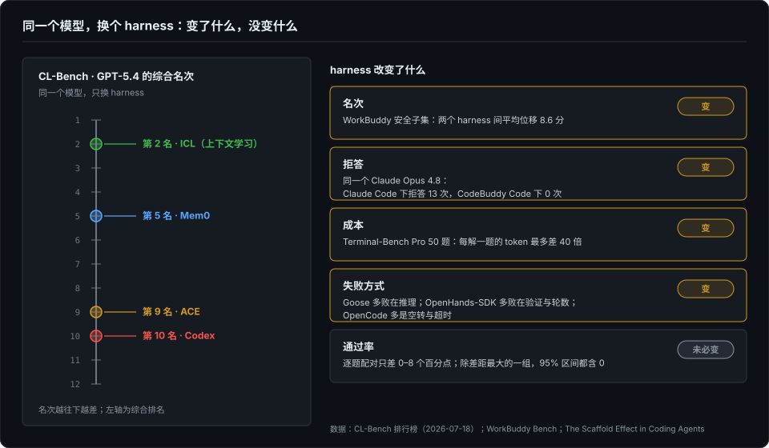
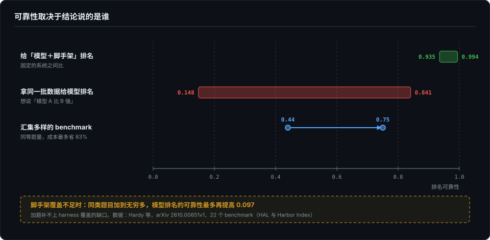

# 换个 harness 排名就翻——被测的到底是谁

> 前九篇的分数都是我自己跑的：题是我出的，对照组是我搭的，翻车也翻在我自己的工具链上。从这一篇起把尺子掉个头——分数是别人给的：排行榜、论文、公开 benchmark。读别人的分数，第一问最朴素：榜单上那一列写着模型名，这个分数到底是谁的？

## 本章将讲

- 同一个模型换个 harness：名次会翻，拒答会变，成本能差几十倍，失败方式跟着 harness 走——通过率反倒未必变。
- 结论靠不靠得住，取决于你想说谁：给「模型＋harness」排名很稳，拿同一批数据给模型排名就不稳；而且加题补不上 harness 覆盖的缺口。
- 想比先固定，想复现先记全；「同一个 harness 版本」至今没有定义，我的三栏拆法。

## 一、我在第 4 篇只敢写半句话

第 4 篇往 skill 里埋伤弹，宿主矩阵的三列里有一列实际跑在兼容端点的另一个模型上。那一节我只敢写半句话：宿主之间的检出行为有差异，可见；谁比谁强，不写。宿主的脚手架和模型两个变量缠在一起，拆不开。第 5 篇翻车之后，工具链又多了一条纪律：宿主配置列为必进报告的格子变量。

当时我以为这是自己实验条件简陋才有的毛病。今年读了一圈公开 benchmark 才发现，它是常态：榜单那一列写的是模型名，分数却从来不只是模型的。harness——把模型包起来、替它调工具、管上下文、决定什么时候停的那一层——一直在场，只是没被写进列名。

## 二、同一个模型，换个 harness

**名次会翻。** Continual Learning Bench（下称 CL-Bench）的排行榜上，同一个 GPT-5.4，接最朴素的上下文学习排第 2，接 Mem0 排第 5，接 ACE 排第 9，接 Codex 排第 10。

WorkBuddy Bench 把 7 个模型放在两个 harness 下并排比：腾讯的 CodeBuddy Code 和 Anthropic 的 Claude Code。三个子集的反应很不一样：

- 代码子集：GPT-5.5 在 CodeBuddy Code 下领先 GLM-5.2（72.90 对 71.54），换到 Claude Code 下反而落后（76.63 对 77.06）。
- 安全子集重排得最厉害，平均绝对位移 8.6 分：GPT-5.5 从第六升到第二，MiniMax-M3 从第二跌到第五。
- 办公子集几乎不动：7 个模型里 5 个变化不到 2 分，绝对位移的中位数是 0.86。

**拒答会变。** 还是 WorkBuddy 的安全题，同一个 Claude Opus 4.8，在 Claude Code 下拒答 13 次，在 CodeBuddy Code 下 0 次。拒答多少，看着像模型的安全策略，其实很大程度取决于 harness 和提示词怎么配合。WorkBuddy 的榜单对所有已执行的运行求平均，等于拒答记 0 分。我的看法是，这会让更谨慎的模型显得更弱；至少该把「有效作答率」和「作答内的分数」分开报。

**成本能差几十倍。** 《The Scaffold Effect in Coding Agents》拿 Qwen 3.6 Plus 和 MiniMax M2.5 两个模型，分别接 Goose、OpenCode、OpenHands-SDK 三个开源 harness，在 Terminal-Bench Pro 的 50 题分层子集上跑：换 harness 之后，每解出一道题花的 token 最多差 40 倍。按第 7 篇的口径，这是 cost per success 换了一个数量级——通过率不动，go/no-go 的裁决照样能翻。

**失败方式跟着 harness 走。** 同一篇论文发现，失败的「指纹」在两个模型之间是一样的：Goose 多半败在推理，OpenHands-SDK 多半败在验证和轮数用尽，OpenCode 多半是空转和超时。决定怎么失败的，更多是 harness，不是模型。

但这篇论文也给了一个反方向的提醒，必须一起记：同一模型在不同 harness 下的通过率，逐题配对比较只差 0 到 8 个百分点；除了差距最大的那一组，95% 置信区间都包含 0。harness 改变的未必是对错，更常是成本、时延和失败方式。注意它用的是配对比较，正是第 8 篇手册里那种设计；换成独立两组比，区间只会更宽。

所以 harness 的影响不能只看总分。它改名次、改拒答、改成本、改失败方式，而且在不同任务上影响的大小差得很远：安全题平均位移 8.6 分，办公题位移的中位数不到 1 分。

## 三、harness 改变的到底是什么

几份工作给 harness 下的定义大同小异。HAL 把脚手架（scaffold）定义为提示词、工具和控制逻辑；The Scaffold Effect 说的是调用工具、管理上下文、决定什么时候停的那一层；Harness-Bench 更宽：管理上下文、工具、状态、约束、权限、追踪与恢复的系统层。

这里面任何一个细节都能挪动分数。WorkBuddy 做过一次诊断重跑：HY-3 只打开「思考内容跨轮回传」这一个开关，同样的三跑协议下，代码题在一个 harness 下涨了 3.82 分，在另一个下涨了 1.92 分。这个开关不是模型的属性，也不是任务的属性，只是适配层里的一个实现细节——却比榜单上大部分差距都大。

连 benchmark 自己的文档也是变量：τ²-bench 实测，只改写领域策略文档的详细程度，成绩就会变。

过程指标同样不能离开 harness 去读。WorkBuddy 的 Claude Code 列里，DeepSeek-V4-Flash 用的输出 token 约是 GPT-5.5 的 3.3 倍（28.6k 对 8.7k），分数却低了 14.74 分。token 用量、轮数、时延，都是「模型＋harness」这个组合的属性。第 1 篇说被测对象是复合体，这里是它的公开版证据。

## 四、想说谁，可靠性就不同

分数既然属于组合，「比模型」还靠得住吗？

今年 9 月，Hardy 等人用贝叶斯方差分解，分析了来自 HAL 和 Harbor Index 的 22 个 benchmark。核心发现是：**可靠性取决于你想下什么结论。**

- 给固定的「模型＋脚手架」系统排名，可靠性在 0.935 到 0.994 之间；
- 拿同一批数据给底层模型排名，只有 0.148 到 0.841。

更扎心的是第三条：如果不确定性主要来自脚手架覆盖不够，那么题目再多——哪怕无穷多道同类题——模型排名的可靠性最多也只能再提高 0.097。他们还发现，汇集多样的 benchmark，在同等题量下能把可靠性从 0.44 提到 0.75，成本最多省 83%。

HAL 自己的数据也是这个意思。同一模型的可比点里，专用脚手架在 CORE-Bench Hard 的 12 组中胜 9 组，在 SWE-bench Verified Mini 的 12 组中胜 11 组；通用的 Generalist 脚手架在 24 次比较中有 20 次更便宜。「哪个模型更强」的答案，取决于给它配了什么脚手架。

这和第 6 篇的结论接得上：归因靠对照，不靠证据强度。想说「模型 A 比 B 强」，harness 就是一个必须被对照掉的混杂变量——要么固定它，要么覆盖多个、报区间。只在一个 harness 上跑，样本量再大，也只是把同一个混杂测得更准。

ABC 清单里有一条（R.6）要求说明评测对象是模型还是 agent 框架。我的看法是，这条今天该写得更具体：一套评测如果既想「固定模型比 harness」，又想「固定 harness 比模型」，就把两种用途分开写，各自固定什么、变什么——它们测的是两样东西。

还有两处容易漏。

一是「固定 harness」常常不完全固定。同一个 harness 接不同模型时，适配层里往往有按模型设置的开关，比如思考内容回不回传、请求直连还是走代理。上一节那 3.82 分说明，这类开关足以改结论。所以「固定 harness 比模型」时，要把每个模型实际生效的适配设置记下来，写明哪些设置因模型而异。

二是数据污染的性质不同。固定模型、比较 harness 版本时，模型见没见过题对两边一样，是共模误差，不太影响「哪个版本更好」；固定 harness、比较模型时，新模型可能见过题、老模型没见过，污染就成了偏向新模型的差模误差。这时私有的留出题集是硬需求。

## 五、想比先固定，想复现先记全

**固定什么。** Harness-Bench 让所有 harness 用同一个冻结的模型服务、同一套任务、同一份预算：上下文窗口 200000、温度 1、最多 150 轮；同时保留各 harness 自己的行为，提示方式、工具、上下文管理和恢复机制都不强行拉平。WorkBuddy 跨 harness 比较时固定的是：推理强度设为 high，上下文统一 200k、用同一个压缩阈值，禁用网页搜索和向用户提问的工具，容器里统一用非 root 用户——因为 Claude Code 拒绝以 root 运行。

**记下什么。** 只记名字不够。HAL 的教训很典型：

- 榜单的一行，是脚手架显示名加主模型显示名；
- 记录的 git 信息不包含工作区有没有未提交的改动；
- 能区分脚手架内容的目录哈希和版本字段，直到 2026 年 4 月才加进来，而公开轨迹的最后一次上传在那之前。

结果是，你没法判断榜上两行用的脚手架内容是不是同一份。

Harness-Bench 做得更细：每个 harness 声明 ID、版本、镜像、协议和配置名；每次运行把实际生效的版本、镜像和预算写进摘要文件；续跑时逐项核对这些身份，一项对不上就拒绝续跑。它的说明写得很硬：改变任一 harness 镜像、任务定义、模型设置或生成预算，就是一个不同的实验，合并工具会拒绝合并不兼容的分片。

**别让配置悄悄回退。** WorkBuddy 有三个做法值得照搬。配置文件刻意不给默认值，缺了映射直接报错，而不是静默套一组错的配置。四层配置合并之后，固化成一份记下所有实际生效参数的清单。每个 harness 版本单独构建成只读镜像，运行时挂进容器；两个适配器从同一个基类从零写起，免得「一边用官方适配器、一边用自写适配器」混进差异。Terminal-Bench 则用一个单行文件钉住它依赖的 Harbor 精确版本——「结果不可比」从此变成一次看得见的文件改动。

这几条和第 3 篇的在场证明是一个方向：不要相信「应该是同一份」，要能拿出「确实是同一份」的证据。

## 六、「同一个 harness 版本」仍然没有定义

做到这里，还剩一个没人解决的问题：改了什么还算同一个版本，改了什么就算新版本？

HAL 只有身份字段，没有等价规则。Harness-Bench 的规则是任何改动都算不同实验——很安全，但回避了问题：改一行日志算不算换版？换一个默认超时呢？

我的拆法是三栏：

1. **可配置维度清单**：系统提示、工具集、权限与沙箱、上下文管理、重试与超时、模型与采样参数，每一项在哪里声明、记成什么字段。
2. **运行身份**：内容哈希、实际生效的配置、镜像 ID，不只是名字和版本号。
3. **同版规则**：明确哪些改动视为等价、由谁裁定；规则定下来之前，默认任何改动都是新版本。

前两栏可以直接借 Harness-Bench 和 WorkBuddy 的做法，第三栏只能自己定。我的建议是按改动的性质分三类：

- **不改变行为的改动**：日志、注释、文档。可以算同一版本，但要拿证据说话——在固定种子的回归题集上，轨迹和结果与改动前一致。
- **改变行为的改动**：提示词、工具集、上下文与恢复策略、默认参数。一律算新版本，旧结果不能沿用。
- **改变资源的改动**：超时、预算、并发。它们是实验条件，不算 harness 本身的版本，但必须进实验身份——Harness-Bench 就把预算写进身份，不一致就拒绝合并。

分类要在跑之前定下来，并由改 harness 的人之外的人裁定。这和第 8 篇的预注册合同是同一个道理：规则先于数据。不然，「这个改动不影响结果」很容易变成一句事后的自我辩护。

## 七、读分数之前：一份检查清单

拿到一个「模型 A 比模型 B 强」或「harness X 比 Y 好」的分数，我会先问六件事：

1. **结论说的是谁？** 模型、harness，还是两者的组合；各自固定了什么、变了什么。
2. **协议轴固定并记下了吗？** 推理强度、上下文窗口与压缩阈值、启用的工具、运行用户、预算。
3. **配置会不会静默回退？** 缺配置报不报错；合并后的实际配置有没有落成清单。
4. **身份记的是内容还是名字？** 哈希和镜像 ID 比显示名可靠；身份对不上，拒不拒绝续跑与合并。
5. **报了成本、时延和失败类型吗？** harness 的影响常在这些维度，不在对错。
6. **覆盖了几个 harness，报区间了吗？** 只在一个 harness 上跑，比不出模型；加题也补不上这个缺口。

## 八、反方与局限

- **harness 对通过率的影响，可能没有对成本那么大。** The Scaffold Effect 的通过率差异多数在置信区间以内；本篇开头的名次翻转，有的就落在噪声范围里。
- **WorkBuddy 的跨 harness 实验规模有限。** 两个 harness、每格三跑平均、没有置信区间；作者自己承认，结果绑定在特定服务端点和两个 harness 的具体构建上。
- **「公平」有不同的含义。** Harness-Bench 的公平是外部条件一致、内部行为各自保留，并不保证 harness 内部机制等价。Harbor 刻意不让任务声明允许使用的工具，理由是工具属于 agent 的一部分；但如果你的工具集是固定的、不是被测维度，在任务里写明反而更简单。
- **这一篇的数字我一个也没复现。** 都来自原论文、原仓库和公开数据。和前九篇不同，这四篇的病例都是读来的——这本身就是读别人分数时的第一条纪律：先分清哪些数是自己跑的。

一句话收住：分数属于「模型＋harness」这个组合。想把它说成模型的分数，先固定 harness，再覆盖多个 harness，最后报区间。下一篇接着问：就算这些都固定好了，分数本身会不会说谎。

## 参考与延伸

- *本篇成书首发，与作者的独立文章《换个 harness 排名就翻：评测 agent 时，被测的到底是谁》同源；事实均取自公开论文、代码仓库与数据，作者未复现任何实验。*
- *CL-Bench 的名次取自其排行榜原始数据 leaderboard_data.json（数据更新于 2026-07-18，2026-11-07 抓取）。*
- *WorkBuddy 的跨 harness 数字、拒答次数与 HY-3 诊断重跑见 Tencent WorkBuddy Bench 论文（arXiv 2607.20911v1，2026-07-23）；配置做法见 Tencent/workbuddy-bench 仓库的 configs/README.md 与 configs/harnesses/HARNESS_AUTHORING.md（2026-10-31 读取）。*
- *The Scaffold Effect in Coding Agents，Vats 与 Golev，arXiv 2607.22585v1（2026-06-08）。*
- *Hardy、Azam、Reuel、Kochenderfer，Agent Evaluation Reliability: More Tasks Won't (Always) Fix An Agent Leaderboard，arXiv 2610.00651v1（2026-09-30）。*
- *HAL（Holistic Agent Leaderboard）据 ICLR 2026 会议版与 arXiv 2510.11977v1；身份字段的时间线据 princeton-pli/hal-harness 仓库 HEAD 16bb03e（2026-07-01 归档）与 HAL 网站（2026-11-06 抓取）。*
- *Harness-Bench 据 Qihoo360/harness-bench 仓库 commit b8d8963（2026-10-09）的 README 与运行工具；Terminal-Bench 的 Harbor 版本钉在其仓库的 .github/harbor-version；Harbor 关于任务不声明工具的理由见其文档 /tasks/environment 的 Tools 一节（2026-10-31 读取）。*
- *ABC 清单的 R.6 见 arXiv 2507.02825v5；τ²-bench 的策略文档实验见 arXiv 2506.07982v1。*
- *宿主矩阵「脚手架 × 模型双变量，差异不做归因拆分」的口径见第 4 篇；「宿主配置列为必进报告的格子变量」见第 5 篇。*
