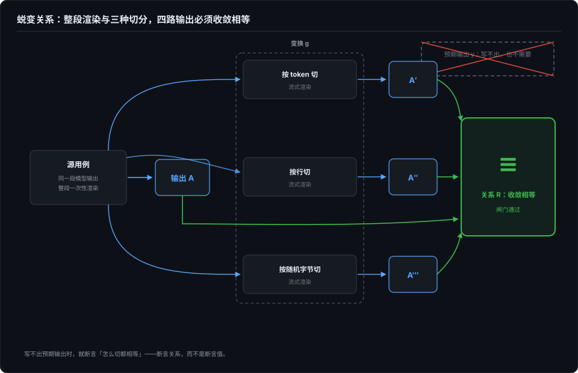
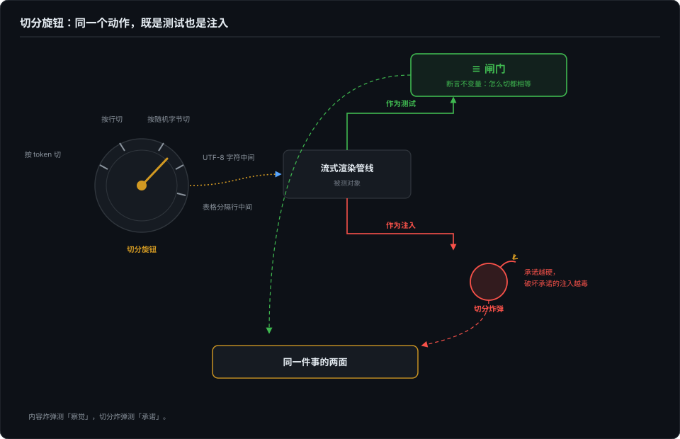
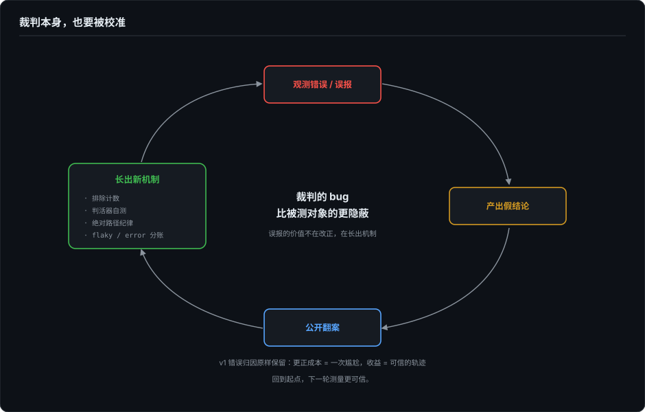
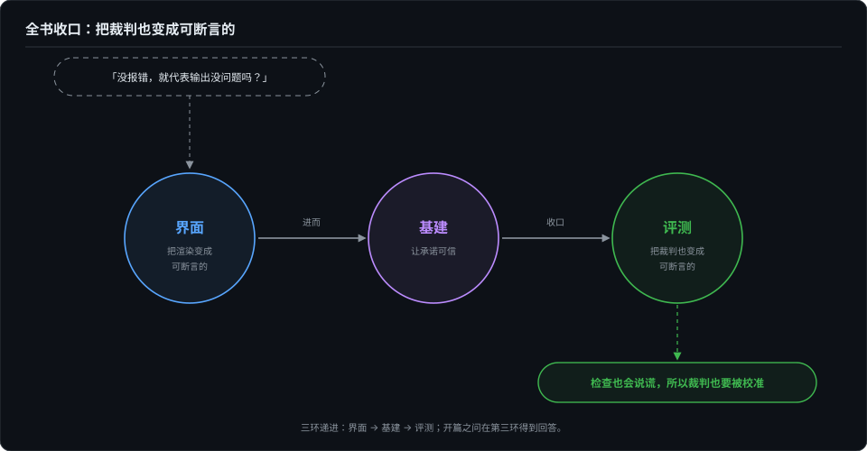

# 断言不了输出，就断言关系——蜕变测试进 agent 评测

> 本卷卷首语立过断言危机：非确定性系统的断言目标从结果移走，当时登记的去处是路径覆盖与终态。但这两个去处都假定「什么叫对」列得出清单——对开放式输出，这个假定本身就漏。这一篇补第三种移法：**断言不了输出，就断言关系。**界面部分第 16 篇的等价性层早就把它用出来了，只是没叫这个名字；这一篇给它正名，并把它从界面层的测试基建，升级成 agent 评测里的一种断言形态。

## 本章将讲

- 断言危机的第三种解法：断言目标从结果移走之后，除了路径与终态，还可以移到关系——蜕变关系为什么是非确定性系统的天然断言。
- 旗舰案例：界面部分第 16 篇的 delta 切分等价性按断言形态重拆——事后形态、全程形态，以及双实现互证这个 oracle 难题的另一种解法。
- 与故障注入合流：每一条蜕变关系反过来都是一张注入地图，切分方式本身就是旋钮——收回第 4 篇。
- 下半场：裁判也要被校准——一次公开误报的完整一生、judge 校准的三条纪律，以及全书的「错误 → 机制化」总单。

## 一、断言目标的三次搬家

卷首语把 agent 的断言难拆成三件事，第一件就是非确定性：同一输入不同输出，精确断言必死，断言目标只能从结果移走。当时登记的去处有两个：**路径**（不管输出是什么，该走的步骤走了没有）和**终态**（不管过程怎么抖，最后落库的状态对不对）。

这两个去处解了一大批问题，但都还带着 oracle 的影子：路径覆盖要求你预先知道「合法路径长什么样」，终态断言要求你预先知道「什么终态算对」。对结构化的任务——订票、改库、跑测试——这两个清单列得出；对开放式的输出，一段回答、一次渲染、一份计划，列不出。你没法为「这次回答该说什么」写预期值，正如你没法为「这段 Markdown 渲染出来该是什么样」逐帧写预期值。

还有第三种移法，这一篇的主角：**移到关系**。不断言输出是什么，断言输出与输出之间必须保持的关系——对输入做一个你选定的变换，输出必须满足一个你指定的关系。正确答案依然不知道，但**不需要知道**了。

## 二、蜕变关系：没有 oracle 时的断言形态

这个手法在软件测试里有正式名字：**蜕变测试**（metamorphic testing），核心概念是蜕变关系（metamorphic relation，MR）。它通常追溯到 Chen、Cheung、Yiu 1998 年的一篇技术报告，动机被叫作 test oracle problem：很多程序事实上没有预言机——要么正确答案不存在（画图、排序检索），要么独立算一遍正确答案和被测程序本身一样贵。教科书例子是三角函数：没有表可查，怎么测 sin 的实现？你不需要知道 sin(x) 的具体值，只需要知道 sin(x) 必须等于 sin(π − x)——同一个程序，喂 x 和喂 π − x，两个输出必须相等。变换是考题，关系是判卷标准，预期值全程没有出场。

一句话定义：**与其断言 f(x) = y，不如断言 f(x) 与 f(g(x)) 之间满足关系 R**——g 是你选的变换，R 是你对系统的理解。源用例跑一遍，把输入按 g 变出后继用例再跑一遍，断言的不是两个输出各自是什么，而是它们之间的关系。

这个形态和 agent 评测是天作之合，理由有三：

1. **oracle 缺位是常态，不是例外。** agent 的产出是开放文本，「正确答案」要么不存在、要么写不起；MR 从设计上就不需要它。
2. **变换是你控制的。** 模型的非确定性在输出侧，而你选 g 的手在输入侧——非确定性还在，但它被关进了「关系必须保持」的笼子：输出可以抖，关系不许破。
3. **一个关系顶一整个用例矩阵。** 切分方式是无限的，逐帧断言永远覆盖不完；关系只有一个，断言一次管所有变换——这正是界面部分第 16 篇说的「一次断言，覆盖无限切分」。

诚实义务也要尽：MR 只能证伪，不能证明。关系被破坏，一定有 bug；关系保持，只是没抓到。这个不对称和第 4 篇故障注入的检出逻辑同构——检出是证据，未检出只是没证据。蜕变测试不是 oracle 的替代品，是 oracle 缺位时的次优制度：次优，但成文。

## 三、旗舰案例：delta 切分是一条教科书级 MR

界面部分第 16 篇讲过 Codex TUI 的四层断言框架，这里不重复，只把第三层（等价性层）单独抽出来，用 MR 的眼光重新拆一遍。它把流式渲染的正确性钉成一句话：「任意 delta 切分下，流式渲染的可见输出必须收敛于一次性全量渲染」——这句话的结构就是教科书级的蜕变关系：

- **源用例**：模型输出整段、一次性渲染；
- **变换 g**：同一段输出的切分方式——按 token 切、按行切、按随机字节切；
- **关系 R**：可见输出收敛相等。

注意这个断言从头到尾没有说「这段 Markdown 渲染出来该是什么样」——它不需要知道。它说的是**切不许改变结果**。正确答案缺位的地方，关系上岗。

`streaming/controller.rs` 里的三个测试（2026-10-14 按快照 commit 6b9826e3 复核行号），按断言形态可以分成两类。

**事后形态**：`controller_loose_vs_tight_with_commit_ticks_matches_full`（L1143）。关系只钉在终点——全部喂完才和全量渲染比一次。一次断言覆盖整个变换，便宜；但失败时你只知道「破了」，不知道在哪一步破的。

**全程形态**：`controller_live_view_matches_render_during_interleaved_table_streaming`（L1619）。关系钉在路径上的每一步——每喂一个 delta 就断言一次「已上屏内容 + 待放行 tail ≡ 全量渲染」。我尤其喜欢它断言失败时的报错设计：报出来的是**出事的那个 delta**，不是预期画面。失败定位的单位从「哪一帧错了」变成了「哪种切法把它切错了」——变换成了第一公民。

两种形态之间是一个工程旋钮：**断言密度**。事后形态便宜、定位粗；全程形态贵、定位到 delta。写 MR 测试时这不是实现细节，是设计决策——关系钉得越密，抓得越早，跑得越贵。和卷首语那句「成本是一等约束」接得上：关系的断言密度，同样要用预算裁决。

## 四、双实现互证：oracle 难题的另一种解法

第三个测试要单独立一类，因为它把 MR 推到了更激进的位置。

`incremental_holdback_matches_stateless_scan_per_chunk`（L1852）：一份有状态的增量实现、一份无状态的全量实现，逐 chunk 断言两者状态相等。用 MR 的语言说：变换 g 是「换一份独立实现」，关系 R 是「两份实现输出相等」。这个形态在文献里有自己的名字，叫伪 oracle（pseudo-oracle）；界面部分第 16 篇的大白话更直接：**用实现验证实现**。

它回答的是 oracle 难题的另一面。MR 的主形态解的是「正确答案不存在」；双实现解的是「正确答案存在，但你信不过任何一份计算」——把绝对正确性问题降级为一致性问题。降级的收益来自独立性：**bug 必须同时以同样的方式污染两份独立实现，才能漏网。**

残余风险也要写明：两份实现共享的错误理解会双双漏过——同一个作者对 Markdown 表格规则的同一个误读，会同时长进两份代码里，一致性全绿，错误隐身。所以双实现不取代真 oracle，它取代的是「手工列预期值」那一层；规格级的误读，最终得靠本章下半场的裁判校准去抓。

顺手和第 6 篇划一下界，免得两种「参照物」混为一谈：双臂对照（with / without）回答「是不是它的功劳」，参照物是被测物自己的另一臂；双实现互证回答「没有 oracle 拿什么当尺子」，参照物是另一份实现。两者的共同祖先是同一条原则——**没有绝对答案时，用参照物替代绝对答案**——分工只在参照物站在哪一侧。

## 五、与故障注入合流：关系是断言，也是注入地图

界面部分第 16 篇末段留过一个反向启发：等价性层指明了最敏感的注入点——delta 切分方式。这一篇把它兑现，而且可以说得更强：**每一条蜕变关系，反过来都是一张故障注入的地图。**

逻辑是这样的。MR 断言「变换 g 下关系 R 必须保持」，等于宣布了系统在哪类扰动下许过承诺；而注入测试要找的最敏感的注入点，恰恰是被许下承诺的地方——承诺越硬，破坏承诺的注入越毒。既然「切分不许改变结果」是承诺，切分方式就是旋钮：按 token 切、按行切、按随机字节切；再往毒里做——在多字节 UTF-8 字符中间切、在表格分隔行中间切、在代码围栏的围栏线中间切。每一种切法都是一颗指名道姓的炸弹，炸的都是同一个不变量。随机扰动只能告诉你「系统可能会坏」；MR 指导的注入告诉你「系统承诺过不会这样坏」——后者才是回归套件里该常驻的东西。

这给了故障注入一个和第 4 篇互补的选题方法。第 4 篇的内容完整性炸弹测的是「坏了会不会察觉」，伤型来自对物理失效模式的枚举；蜕变注入测的是「变换下还守不守承诺」，伤型来自对系统承诺的枚举。两份清单最后往往指向同一批部件，但后者多了一层「违约」的语义——检出的 bug 自带呈堂证供：不是「这里坏了」，是「你承诺过这里不会坏」。**不知道往哪注入的时候，先问系统承诺过什么。**

所以合流是字面意义的：造得出变换，才写得出 MR；写得出 MR，变换才不只是随机扰动，而是带着承诺条款的考题。第 4 篇从注入一侧到过这个交界，这一篇从断言一侧再走一遍——交界还在原地：断言不了输出，就断言关系；而关系画出的地图，测试与注入共用。

## 下半场：裁判也要被校准

前五节把断言目标搬到了关系上。但断言再精巧，举着断言的仍是人写的评测系统——而评测系统自己也是软件，也会坏。上半场答「拿什么当判据」，下半场问「判错了怎么办」：这个系列翻过的每一次案，最后都指向同一件事——裁判本身也要被校准，评测系统的 bug 比被测对象的更隐蔽。这既是本卷收口，也是全书收口。

## 六、一个误报的完整一生

我给 skill-up 提过两个挨着的 issue。第一个是真问题（超时强杀引擎，产物文件整个蒸发），后来成了 issue 加修复 PR。第二个，第二天我自己回到 issue 下面发了一条评论：「这是一个误报，skill-up 的行为完全正确，请关闭。」

误报的诞生现场很体面。为了补回超时丢失的数据，我单 case 重跑了三次，每次控制台都报 `1 passed`，但产物目录里结果文件依然不存在。发 issue 前我还做了个「严谨」的复现：记录文件 mtime，重跑，再记录——mtime 纹丝不动。「重跑报 PASS 但产物零更新」，铁证如山，我把它连同命令输出一起写进了 issue，标题起得很有把握。

两天后准备提 PR，加 `-v` 复现，一条 DEBUG 日志把我击毙：重跑的产物 append 进了新的 iteration 目录——文档里写得明明白白的语义，行为完全正确。我的两个观测错误原形毕露：**其一**，三次补跑是在子目录里敲的，相对路径的产物老老实实写进了嵌套目录，而我检查的是仓库根下的同名目录；**其二**，那个「严谨」的 mtime 复现，stat 的是旧 iteration 的文件——**mtime 是真的，数字是一致的，结论是错的**。我验证了一个没人怀疑的命题（旧文件不会被改写），却以为自己验证了那个有问题的命题（新文件没有写出）。还有一个隐形的帮凶：头一天那个真实的超时丢产物问题给了我「产物会丢」的先入之见，让我对「又一次丢失」毫无防备。

每一格观测都「对」，拼起来的图景却是虚构的。这就是第 3 篇那条定律在观测者身上的版本：两个世界产出同一组证据，而我对它们的差异是盲的。

## 七、公开翻案的成本与收益

发现真相当天，我在原 issue 下发了更正评论：说明行为正确、给出日志证据、逐条拆解自己的两个观测错误、指出唯一真实的问题、道歉并请关闭。写这段评论花的时间比写原 issue 还长——这是应该的。**公开误报的成本是一次尴尬，收益是维护者的时间和一个可信的轨迹记录**：下次你再报问题时，你的历史记录在替你说话。

回头看，那组「铁证」有一个性质值得单独说：**证据质量不保证结论正确，它保证的是纠错的速度。** 最小复现、环境信息、内联证据，这些纪律没能阻止我犯错，但让我的错误可被快速验证和推翻——verbose 日志一跑就水落石出。第 3 篇的「不可判定」标注、第 6 篇归因文件里原样保留的错误结论，是同一条纪律的不同形态：给将来的纠错留抓手。

误报调查还顺手孵出了真修复。读源码时发现我在 issue 里建议的修法和真实缺口对不上——上游早有优雅终止，缺的是「超时且产物缺失时合成一份最小结果文件」这个兜底，于是 PR 做的正是 issue 里我自己标的备选方案，PR 描述里专门开了一节说明与 issue 提纲的出入。**issue 里的修复建议是假设，不是承诺**——维护者看到的不是一个推翻自己的别扭 PR，而是一份诚实的调查记录。

## 八、绿灯也会骗人

两天后我又翻了一次车，方向相反。

我提的 PR 在 CI 上红了、本地全绿。第一反应是教科书式的：「平台差异」——Linux 与 macOS 的进程管理差异。我把上游的超时处理、错误分类、kill 升级的时序读了一个小时，越读越觉得每一处都平台无关，但又找不到别的解释。

真正的突破口不是读代码，是一条 `git log`：上游早几天合入了一个语义收窄的改动（框架自写文件改登记进内部字段），而 GitHub 的 `pull_request` 构建的是「分支 ⊕ 最新 main」的合并态——**CI 测的代码和我本地测的，不是同一份**。merge 文本上干干净净，一个冲突标记都没有；语义上，上游把我们断言依赖的行为拆走了。merge 干净只证明两边没改同一行，不证明两边对同一个字段的理解还一致。

所以「CI 红、本地绿」的第一个问题不该是「平台差在哪」，而是「CI 测的是哪份代码」。我为一个不存在的平台差异读了一个小时源码——那一小时里我离真相的距离，比不看代码还远。修法很轻：断言从「字段」改绑到「字段的职责」——上游重构会让字段贬值，职责才扛得住（Hyrum 定律的标准剧情：可观测行为足够多，就总有人依赖它）。

## 九、judge 也要被校准

裁判链条上还有一类裁判不是脚本，是模型。judge 的校准纪律，我的口径是三条：

- **TPR 与 TNR 分开看。** 「抓得出坏的」和「放得对好的」是两个独立能力，一个高一个低的 judge 很常见。聚合成一个准确率，等于让两种病共用一张化验单。
- **Unknown 必须是合法判决。** 不许强制二选一。判不了的样本标 Unknown 退出，硬判的 judge 会把噪声抛光成信号。
- **校准集优先用有机失败。** 合成坏样本是出给 judge 的送分题；真实运行里攒下来的失败，分布才和战场一致。校准集与验证集分开，校准集本身有保质期——这些和 RAG 检索评测是同一条纪律的两种说法。

不校准的代价有公开数字：CORE-Bench 上评分器的刚性判分 bug（期望 `96.124991…` 而拒收 `96.12` 这类），能把实际 95% 的模型压成 42%。**裁判的 bug 不只漏报，还会批量制造冤案**——而它被采信的程度和正常裁判一模一样。

## 十、错误 → 机制化：全书方法论清单

本卷每一章的翻车，最后都长成了一条机制。收拢成一张总单：

| 翻车 | 长出的机制 |
|---|---|
| 产物「消失」的误报（本篇） | 排除计数显式上报；单 case 重跑一律绝对路径；判产物看最新 iteration |
| 判活器自身崩溃 | 评测器自测套件 32 条断言（含故意的坏样本），上线首日就抓到自己崩溃 |
| PASS/FAIL 摇摆 | flaky 分账：flaky rate 与 error rate 分开记账，不许互相掩护 |
| 孙进程孤儿化挂死 runner | 进程组杀 + 「孙进程必死」回归断言 |
| mock 方言说错 | 每种故障配「必然触发现有检测」的阳性对照变体 |
| 目录名泄露伤型 | 宿主可见路径全部哈希暂存；实验产物对宿主不可见 |
| 超时用例从分母消失 | 排除计数（同上，两个事故共用一条机制） |

这张表是全卷真正的产出物。工具会过时，数字会过期，「每次翻车长出一条机制」这个循环不会。

## 十一、全书答毕

回到全书开篇的那句问话：没报错，就代表输出没问题吗？

四卷各回答了它的一层。界面部分答了渲染层：把带状态的字节流逐层翻译成可断言的东西（第 16 篇的四层翻译）。基建卷答了协议层：complete 是排除出来的兜底，不是默认值；字节到没到，渲染层永远无权裁决。评测卷答了行为层：非确定性、成本约束、复合被测对象之下，断言目标三次搬家（路径、终态、关系），四问各有人认领。然后这一篇补上最后一环：**观测层**——连「发现问题」这件事本身，也会以自洽的方式出错，也需要被测。

所以最终答案是：**没报错什么也不代表——除非你为「发现问题」这件事本身也建了断言。** 观测会骗人、考题会骗人、对照组会骗人、绿灯会骗人，而裁判——包括拿着工具的那个人——始终在被校准的途中。这个系列抓了这么多 bug，最后一个永远是自己的。

---

*本章源码事实基于 Codex 本地源码 2026-10-14 的复核：`codex-rs/tui/src/streaming/controller.rs` 三个测试分别位于 L1143、L1619、L1852，快照 main `6b9826e3`（2026-09-09）；四层断言框架与三个测试的行为细节见界面部分第 16 篇，本章只取断言形态视角，不重复展开。蜕变测试的概念定性（property-based 测试技术、应对 test oracle problem）2026-10-14 经 Wikipedia 词条核验；具体出处（Chen、Cheung、Yiu 1998 年技术报告）为教科书通识，按转述口径引用，未逐字核对原文。*
- *本章收编自已发布博客《我给 skill-up 报了一个不存在的 bug》（2026-09-20）与《CI 红、本地绿：一次「平台差异」误诊，和 merge 干净不等于语义兼容》（2026-09-22）；上游记录：skill-up issue #263、误报更正 #264、PR #265，语义变更上游 PR #250。*
- *judge 校准三条纪律为作者的工作口径；CORE-Bench 评分器 bug 的数字（95% → 42%）转述自 Anthropic 的 agent evals 专文，以原文为准。*
- *判活器自测套件与排除计数机制在 huohou 仓库 evals-shared（2026-09 起）；进程组杀修复在 dsh-eval-harness v0.6.0。*
