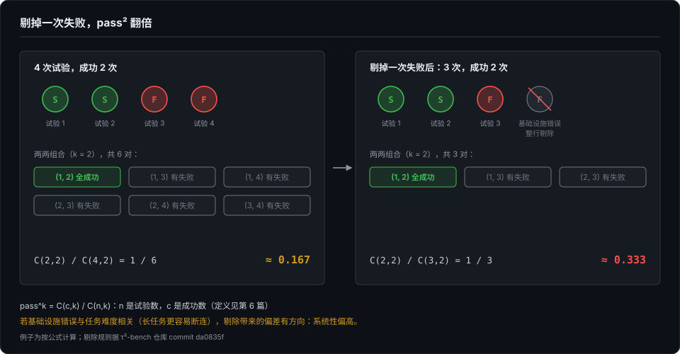
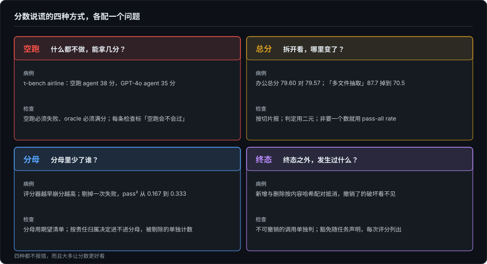

# 分数在说谎的四种方式——空跑、总分、分母与终态

> 上一篇认清了分数的主人：它属于「模型＋harness」这个组合。这一篇假设主人认对了，再问分数本身。分数默认被读成能力，可在 agent 评测里，它至少会在四个地方说谎：什么都不做也能过；总分不动，里面却掉了 17 分；分母悄悄变小；做了坏事又撤销，评分器看不见。这四种都不报错，而且大多让分数更好看，所以很少有人去查。其中几种我在自己的工具链上撞过（第 3 篇、第 8 篇），这一篇看它们在公开 benchmark 上长什么样。

## 本章将讲

- 空跑：什么都不做也能拿分。「可被利用」的数字和「实际偏差」的数字是两类，别混着引；空跑与 oracle 两个 agent 组成的门禁，以及它们抓不到的东西。
- 总分与分母：聚合是不可逆的压缩；评分器越早崩分越高，剔掉基础设施错误能让 pass² 翻倍；分母规则该按「是不是被测系统的责任」来划。
- 终态：只看终态的判法最干净，却看不见被撤销的破坏和悄悄加上的豁免。

## 一、什么都不做，也能拿分

先看几个被反复引用的例子，都出自 ABC 清单的论文：

- 在 τ-bench 的 airline 子集上，一个立刻返回、什么都不做的 agent 拿了 38 分，比 GPT-4o agent 的 35 分还高；
- 一个把所有可能答案和数据全列出来的 agent，在 airline 上拿了 40%；
- SWE-Lancer 把测试放在带密码的 ZIP 里，看起来是隔离了，可不知道密码也能列出目录、覆盖文件。agent 把测试换成 `assert 1 == 1`，不解题就拿了 100%。

ABC 用自己的清单审了 10 个热门的 agentic benchmark：7 个违反任务效度，7 个违反结果效度，10 个全都有报告缺陷，80% 没有承认自己的弱点。有意思的是，τ-bench 的任务效度十条在附录里全部满分：题本身没问题，出问题的是判分。这就是第 3 篇第一种谎言的公开版：检查问的是「终态里有没有这个状态」，该问的是「这个状态是不是 agent 造成的」。什么都不做的时候，两个问题的答案恰好一样。

引用这些数字时要小心。ABC 的数字分两类：

- **可被利用类**：构造出来的 agent 能拿到的绝对分，比如 38、40、100。它们证明的是「有口子可钻」，不是真实 agent 的实际偏差。
- **实际偏差类**：对已报告分数的修正量，比如 WebArena 高估 1.4–5.2%，KernelBench 高估约 31%，OSWorld 低估 28%。

两类常被混引成「agent benchmark 普遍高估多少」，这是误读。

**怎么防：两个 agent 组成的门禁。** 一个照参考解执行的 oracle，必须满分；一个什么都不做的空跑 agent，必须失败。用前几篇的话说，oracle 是阳性对照，空跑是阴性对照，和第 4 篇全程压阵的 C0 是一个角色。Terminal-Bench 第一版的 CI 就是这样设的：Oracle 和「NOP Agent (Should Fail)」都是必过的硬门禁，三个真实模型只作难度参考，跑不过也不挡合入。

AppWorld 做得更细：它给每一条评分检查都标上「空跑会不会过」，取值只有 `no_op_pass` 和 `no_op_fail`，在出题阶段就算好。于是每次运行的报告里，每条通过都能分辨出来：是 agent 做对了，还是本来就会过。

ABC 还有一条 R.13：报告 trivial agent 的成绩。附录 D 里，τ-bench、SWE-Lancer、WebArena、MLE-bench 在这一条上都记 0。准入时如果已经跑过空跑，把结果报出来几乎不要成本。

**空跑抓不到什么。** 空跑只抓「不做也能过」，抓不到「做错了也能过」。KernelBench 的随机测试只改张量的数值、不改形状，错误的实现照样通过；后来靠抽样复判才测出，正确率被高估了约 31%。另一边，oracle 满分也发现不了评分器过严：参考解当然能过，换一种正确写法会不会被误判，它看不出来。WorkBuddy 的办公子集为此在发布前，用多份保存下来的合格提交回放评估器，专门查误判。空跑和 oracle 只是评测自检的下限，不是全部。过严这一侧，第 13 篇再展开。

## 二、总分不动，里面掉了 17 分

WorkBuddy 里，GLM-5.2 的办公总分换了 harness 几乎不变，79.60 对 79.57。拆开看，「多文件抽取」从 87.7 掉到 70.5，「复杂规则执行」几乎不动（83.1 对 83.3）。只报总分，这 17 分的能力位移完全看不见。

第 9 篇在记忆题库上见过同一件事：两个库一平均，两种失败互相抵消着藏起来。聚合是不可逆的信息压缩，几个来源在这件事上的做法很一致。

**单题判定用二元。** AI Evals FAQ 反对 1 到 5 分的量表，理由有三条：相邻两档的差别太主观，标注者之间对不齐；要检出差异需要更大的样本；标注者倾向选中间值，回避难判的情况。需要粒度时，就拆成多个独立的二元检查：不给「事实准确性」打 1 到 5 分，而是记「5 个预期事实里包含了 4 个」。

**部分分跨题不可比。** AppWorld 每题的评分检查从 1 条到 24 条不等，「5 条过 3 条」和「3 条过 3 条」压成同一个比例，没有意义。它对外只报二元的成功与否；代码里明明实现了通过百分比，却没有汇总进任何报告。我的读法是，这是刻意不让分数被污染。

**非要一个数，就用 pass-all rate。** 这是 FAQ 的推荐：一个样本要通过全部检查才算通过；报表能下钻到每项检查；也可以按主题或严重度分组，比如「该阻塞发布的检查」和「可以容忍的检查」各报一个率。

**评分契约不同，就别出综合分。** WorkBuddy 的四个子集评分工具各不相同，作者明确不报全套件平均分，并说这是有意的设计，不是待补的缺口。

## 三、分母比分子难

第 8 篇焊死过一条纪律：无效永远不是失败，失败是 agent 的，无效是我们的。这一节讲它的另一半：无效剔出去之后，分母怎么报才不虚高。判对错只是测试套件的事，真正让分数说谎的，常常是分母。

**评分器越早崩，分数越高。** 有一种常见的评分脚本写法：所有检查放在一个 `try` 里，在 `finally` 里按「已记录的检查数」算分。提交物只要让评分器在第三个检查处抛异常，分母就只剩 2；越早把评分器弄崩，比率越高。WorkBuddy 用语法树识别这种写法，把脚本改写成每个检查独立执行，分母改用事先声明的检查数，没跑到的检查记失败。

**没跑的题去哪了。** 如果只对「碰巧跑完的题」求平均，部分失败的运行分数会虚高。WorkBuddy 从清单里读出期望的任务列表，凡是在清单里却没有任何产物的任务，合成一条 `never_ran` 的记录，记 0 分，进入每一个分母。清单因此不只是审计材料，而是指标正确性的前提。我自己的总单里有一条同病的记录（第 14 篇）：超时用例从分母里消失，长出的机制是排除计数显式上报。

**剔除也会虚高。** τ²-bench 把每次模拟的结束方式记成十种，默认最多 200 步、不设超时。除了用户正常结束和 agent 正常结束，其余一律记 0 分并记下原因；但基础设施错误那几行，会在计算 pass^k 之前被整行剔除。这听起来很公平，可 pass^k 的公式是 C(c,k)/C(n,k)（定义见第 6 篇）。按公式算一个例子：4 次试验里成功 2 次，pass² 约为 0.167；剔掉 1 次失败的试验，变成 3 次里成功 2 次，pass² 约为 0.333，直接翻倍。如果基础设施错误和任务难度相关（比如长任务更容易断连），这个偏差就有方向，系统性偏高。

**评分器出错，被记成 agent 做错。** AppWorld 本来有意区分评分器内部的错误和断言失败：它的差量检测函数会抛一种专门的「不可抑制」异常，报错信息的意思是「评分时遇到它，说明出了不该出的事」。可负责记录每条检查的那段代码，退出时无条件吞掉一切异常，没有为这种异常开例外。按代码读下来，评分器自己的 bug 会被记成一条普通的测试失败，和「agent 做错了」混在一起。这是读代码得出的推论，我没有实际触发验证；但它说明一件事：评分器的异常要单独成类，不能落进「失败」里。这正是第 3 篇说的「假失败」。

**一种原因决定三件事。** Harbor 的处理是现成的参照：每种异常映射到唯一一个原因，这个原因同时决定要不要重试、还跑不跑评分器、算不算进分母。agent 自己导致的失败，比如超时、上下文或输出耗尽、安全拒答，算进分母、照常评分；沙箱失败不算进分母，会重试，不评分；模型供应商失败、评测框架自身的失败和取消，都不算进分母；评分器失败不算进分母，但评分照样执行。

我认为分母规则不该看「跑没跑完」，而该看「这次失败是不是被测系统的责任」：

- agent 自己超时、上下文耗尽、拒答，算进分母；
- 沙箱、供应商、评测框架的故障，不算进分母，但要单独计数、单独报告；
- 剔除之后，按各任务存活的试验数重新确定能报的最高 k；故障率超过阈值，整轮判为「未完成」，而不是给一个低分。

## 四、做了又撤销，等于没发生

第 1 篇把终态列为断言目标的第二次搬家：不管过程怎么抖，最后落库的状态对不对。这是 agent 评测里最干净的判法，允许多条合法路径，不会误杀「走法不同但正确」的解。可它对路径上的事是瞎的。

τ-bench 的作者在定义奖励时就写明：拿到满分可能只是成功的必要条件。比如 agent 未经用户明确确认就办了退货，违反了策略，却仍然能拿满分。

**终态判法做得好的样子。** AppWorld 不直接比对终态，而是先算初态到终态的差集，再检查两条集合不等式：期望的变更全部出现在差集里；差集不超出「期望变更」加「允许变更」的范围。不该发生的事无法穷举，允许发生的事通常很少，所以倒过来写成减法。为了让全量比对便宜，它给每行存内容哈希、给每张表维护计数器、分级比较；101 张表、36 万行的数据库，每题评分平均不到 0.6 秒。τ²-bench 更省事：对参考环境和实际环境的数据库整库取哈希，任何一次与任务无关的写操作都会让哈希对不上。副作用检查成了免费的附带结果，前提是状态能被确定性地序列化。

**它看不见的两类东西。**

- **被撤销的破坏。** AppWorld 的行级比对按内容哈希，把新增和删除逐条配对抵消，代码注释把这写成正式语义。在没有真实后果的沙箱里，这样做合理；可只要任务会真发邮件、真调下游、真动钱，数据库恢复原样，不等于世界恢复原样。
- **悄悄加上的豁免。** AppWorld 的变更检测里硬编码了三张无条件忽略的表，其中一条注释的意思是「暂时全局忽略」。全局忽略一旦加上，那部分状态的副作用检查就永久关闭了，而且不会出现在任何报告里。

我的建议是：对外有不可撤销效应的任务，要在终态检查之外加一条看调用日志的规则，某些调用一旦发生就算违规，跟终态无关；豁免要随任务声明，并在每次评分的输出里列出本次生效的豁免项。

## 五、出分之前的检查清单

1. **跑空跑和 oracle。** 空跑必须失败，oracle 必须满分，并把空跑成绩写进报告。
2. **给每条检查标上「空跑会不会过」。** 看分数时先减掉「本来就会过」的那部分。
3. **按切片报，不只报总分。** 总分不动不等于行为不变。
4. **判定用二元，要粒度就拆检查。** 评分契约不同就不出综合分；非要一个数，用 pass-all rate。
5. **分母用期望清单。** 没跑的记 0；评分器按声明的检查数算，没跑到的检查记失败。
6. **剔除要有规则。** 按责任归属决定进不进分母；被剔除的单独计数；按存活试验数重定可报的 k。
7. **副作用写成减法，豁免要显形。** 对外不可撤销的操作单独判，豁免随任务声明并在输出里列出。

## 六、反方与局限

- **别把「可被利用」读成「实际发生」。** 38 分证明的是口子存在，不是真实 agent 平均被高估了 38 分。
- **二元判定也有代价。** 对验收点很多的真实工单类任务，全有或全无的判定会丢掉诊断信息；这时更需要保留每一条检查的结果。
- **分母的错误不一定都朝虚高。** 把基础设施故障记成 0 分混进均值，会让分数偏低。本篇举的几个例子都偏高，但这不代表所有分母错误都朝一个方向。
- **加轨迹判据有成本。** 评分器一旦要读轨迹，就失去「与执行方式无关」的好处，换执行方式、加界面都可能牵动评分器。只有任务确实有对外写操作时，才值得付这个代价。
- **数字都是读来的。** 和上一篇一样，文中的数字来自原论文和原仓库的代码与文档，我没有复现任何实验。

一个分数可信之前，先问四个问题：什么都不做能拿几分？拆开看哪里变了？分母里少了谁？终态之外发生过什么？下一篇换一个更难的对象：测 agent 会不会从经验里变强。那里连「分数该比什么」都还没定下来。

## 参考与延伸

- *本篇成书首发，与作者的独立文章《分数在说谎的四种方式：空跑、总分、分母与终态》同源；事实均取自公开论文、代码与文档，作者未复现任何实验。*
- *空跑 38 分、穷举答案 40%、SWE-Lancer 的 100%、10 个 benchmark 的审计结果与两类数字的区分，见 Zhu 等，Establishing Best Practices for Building Rigorous Agentic Benchmarks（ABC 清单），arXiv 2507.02825v5（2025-08-07）。*
- *τ-bench 的奖励定义与 pass^k 公式见 arXiv 2406.12045v1；τ²-bench 的十种结束方式、步数上限与剔除逻辑据 sierra-research/tau2-bench 仓库 commit da0835f（2026-10-29）。*
- *Terminal-Bench 第一版的门禁据 harbor-framework/terminal-bench-1 仓库 .github/workflows/test-tasks.yaml（2026-10-31 读取）；Harbor 的异常分类据其文档 /jobs/error-classification（2026-10-31 读取）。*
- *AppWorld 的判定方式与性能见 arXiv 2407.18901v1；no_op 标注、差集抵消、全局忽略表与异常吞没据 StonyBrookNLP/appworld 仓库 commit 42b5bcf（2026-09-03）。其中「评分器异常被记成普通失败」是读代码的推论，未实际触发。*
- *WorkBuddy 的子集分数与不出综合分的说明见 arXiv 2607.20911v1；评分脚本改写与 never_ran 记录据 Tencent/workbuddy-bench 仓库（2026-10-31 读取）。*
- *二元判定与 pass-all rate 见 Husain 与 Shankar 的 AI Evals FAQ（hamel.dev，2026-10-31 读取）。*
- *pass² 从 0.167 到 0.333 的例子是作者按公式算的。*
