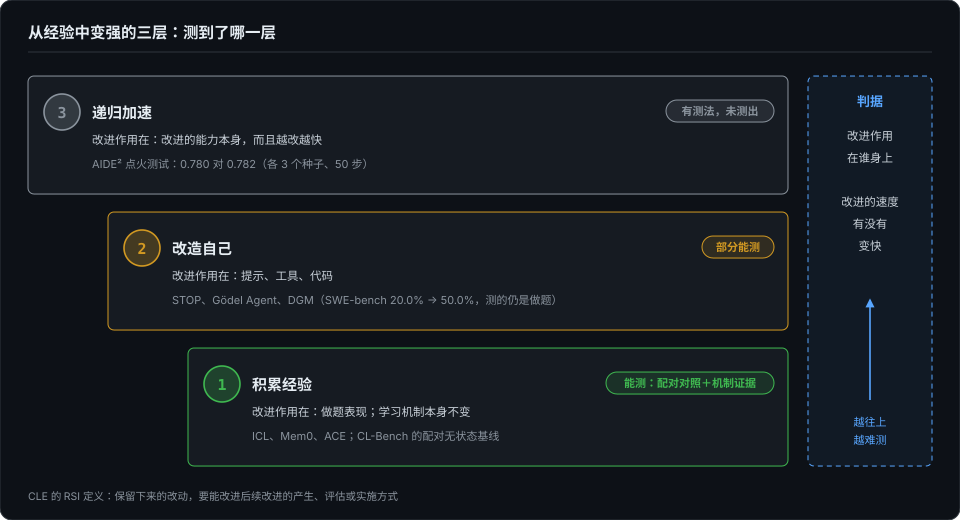
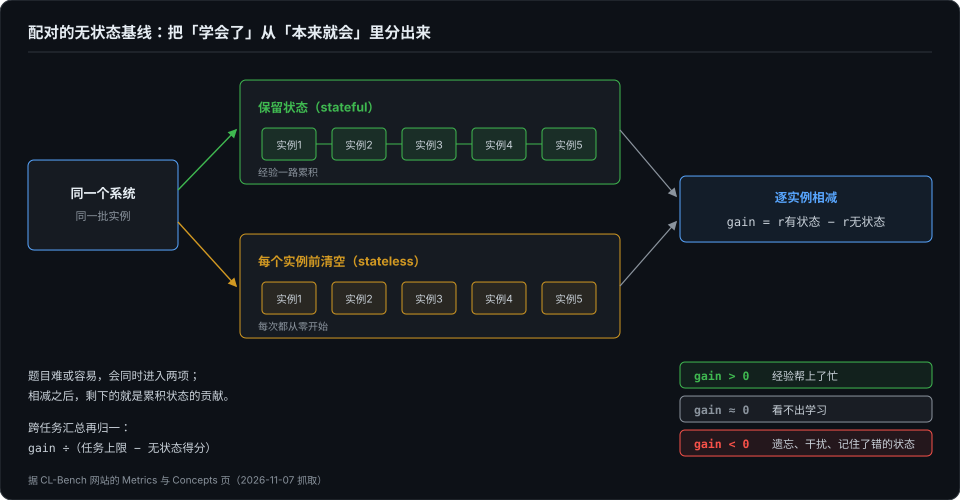

# 测「会学」容易，测「越学越快」难——从持续学习基准到 RSI 评测

> 第 9 篇测的是我能做配对实验的那种记忆：同一道题，有记忆跑一遍，没记忆跑一遍。今年公开 benchmark 也开始测「agent 能不能从经验里变强」，好几个标题里还写着 RSI。我把它们读了一遍，结论是：第一层「会学」已经能测得比较干净；「越学越快」有人设计出了测法，但还没有测出结果。

## 本章将讲

- 「从经验中变强」分三层：积累经验、改造自己、递归加速。判断属于哪一层，看改进作用在谁身上，以及改进的速度有没有变快。
- 第一层要两样东西：配对的无状态对照，加上机制证据。标题写着 RSI 的 benchmark，有的连第一层都还没分离出来。
- 第二、三层的测法，以及唯一一次正面测「加速」的实验；被测物能改自己时，评测就多了一个对手，只能靠结构隔离。

## 一、把历史塞进上下文，赢了专门的记忆系统

Continual Learning Bench（下称 CL-Bench）测的是一件事：agent 做一串相关任务时，能不能从前面做过的任务里学到东西，越做越好。上一篇借它的名次讲 harness；同一张榜换个角度看，还有一个更扎眼的现象：

- 同一个 GPT-5.4，接最朴素的上下文学习（in-context learning，ICL），也就是把做过的题和反馈直接拼进上下文，综合排第 2；换成专门的记忆系统 Mem0 排第 5，ACE 排第 9，Codex 排第 10；
- Claude Sonnet 4.6 也一样：接 ICL 排第 1，接 Claude Code 排第 3。

论文摘要说得更直接：朴素的 ICL 胜过专门做记忆管理的系统。这也不是孤例。8 月发布、10 月改到第三版的 ContinualSkillBench 发现，在两个模型、三个领域上，只保留上下文和反馈、不去维护技能库，平均表现和维护一个显式技能库几乎一样。

读到这里，很多人会想到递归自我改进（recursive self-improvement，RSI）：系统从经验里变强，变强之后改进得更快，一路加速。10 月底发布的 Continual Learning Exam（下称 CLE），标题里就写着「Long-Horizon RSI」。

上个月我在博客《RSI：叙事用完成时，机制用进行时》里对过一个项目的表：RSI 的主张写成了完成时，代码里对应的机制还是默认关闭的实验开关。这一篇换一个角度，不看谁宣称了 RSI，看 benchmark 实际测到了哪一层。我的回答是：这些 benchmark 测到的「会学」和 RSI 之间，至少还隔着两层。

## 二、三层：积累经验、改造自己、递归加速

我把「从经验中变强」分成三层：

| 层次 | 改进的是什么 | 例子 | 现在测得到吗 |
|---|---|---|---|
| 1. 积累经验 | 做题表现越来越好，学习机制本身不变 | ICL、笔记本、Mem0 这类记忆系统 | 能，前提是有配对对照 |
| 2. 改造自己 | 系统改自己的提示、工具或代码 | STOP、Gödel Agent、Darwin Gödel Machine | 部分能，多是论文自带的评测 |
| 3. 递归加速 | 改进的是「改进的能力」本身，而且越改越快 | 严格意义上的 RSI | 有人设计了测法，还没测出结果 |

判断属于哪一层，看两点：改进作用在谁身上；改进的速度本身有没有变快。

CLE 给 RSI 下的定义很清楚：被保留下来的改动，要能「improve how subsequent improvements are generated, evaluated, or implemented」。它还特意说明，在线学习、测试时训练、案例复用，都可以在学习过程固定不变的情况下进行，单用它们并不构成 RSI。这正是第一层和第三层的分界：前者积累的是做题的知识，后者改进的是获取知识的过程。

第二层的例子不少：

- STOP 让一个调用语言模型的「改进程序」去改进它自己的代码；
- Gödel Agent 让 agent 借助大模型，在运行中修改自己的逻辑和行为；
- Darwin Gödel Machine（下称 DGM）让编码 agent 反复改写自己的代码，把生成的变体存进档案库，每次改动都在编程 benchmark 上检验。

DGM 的摘要说，这样改下去，它修改自己代码的能力也在提高，这已经碰到了第三层。但它实际报告的是 SWE-bench 从 20.0% 涨到 50.0% 这类分数，而不是改进的速度有没有越来越快。改的是「自己」，测的仍然是「做题」。

## 三、第一层怎么测才算测到

测第一层，最容易犯的错，是把「本来就会」当成「学会了」。一个强模型在后面的题上得分高，可能只是因为它本来就强，和前面做过什么没有关系。

CL-Bench 的解法是配对的无状态基线（stateless baseline）：

- 同一个系统跑两遍：一遍保留状态，一遍在每个实例之前清空；
- 对每个实例，用前者的得分减去后者，得到 gain；
- 某个实例对这个系统来说难或容易，会同时体现在两项里，相减之后，剩下的就是累积状态的贡献。

这就是第 8 篇手册里的配对：让每个任务自己跟自己比，把题目难度这个最大的噪声项从分母里消掉。文档也承认，难度和累积状态之间更细的交互，这样减并没有完全消掉。gain 的读法有三种：为正，经验帮上了忙；为零，看不出学习；为负，累积的东西反而有害，比如遗忘、干扰信息越积越多，或者记住了错误的状态。跨任务汇总时，它再按「还剩多少提升空间」归一：gain 除以任务上限与无状态得分之差。

8 月发布的 PAST-Bench 又往前推了一步。它同样在相同条件下打开、关闭保留的经验做对比，覆盖 26 个场景、204 个回合；但它不只看分数涨没涨，还检查涨分是不是走了预期的路径：经验有没有被保存、被检索、被更新。结果是，总分涨幅相同的两个系统，在路径证据上可以差得很远。这三件事和第 9 篇的三层乘法链（写入、检索、采信）几乎一一对应。分数对了，原因不一定对；不逐层记录，「学到了」和「记忆系统没用」一样，都是无法证伪的话。

反过来看 CLE。它的规模很大：

- 50 多位领域专家出题，120 个任务，每个分 5 级，共 600 级；
- 覆盖 89 个职业角色、12 个领域；
- 最好的系统只过了 47.7% 的级别，5 级全过的任务只有 23.3%。

但它的测法是：每个系统按一个固定顺序，把 120 个任务串行跑一遍；Trial 1 每级只能交一次，Trial 2 在交错之后可以看诊断反馈再交一次。两者之差，测的是「反馈加重交」的作用，完成率的中位数提升了 5.3 个百分点。作者在结果部分自己写明：要评估跨任务保留下来的知识起了多大作用，需要另做一组「每个任务前把 harness 重置回初始状态」的配对比较。这组比较，文中没有做。

所以，CLE 的数字说明了任务难，没有说明学到了多少。标题写着 RSI，它连第一层的「学会了多少」都还没分离出来。

测第一层，至少要两样东西：配对对照，把「学会了」从「本来就会」里分出来；机制证据，确认涨分走的是预期的路径。

## 四、读这类榜单的几个坑

配对对照解决了「测什么」，榜单怎么读还有几个坑。以 CL-Bench 为例：

- **前四名挤在噪声里。** 前四名的综合归一 reward 分别约为 0.196、0.189、0.185、0.183，首尾只差 0.013。而单个任务上，5 次运行之间的波动很大：排第 2 的 ICL · GPT-5.4，在 codebase_adaptation 上归一 gain 的标准差约 0.41；全榜最大的是 ICL · Gemini 3.1 Pro 在 cohort_studies 上，约 0.87。首页只给名次，不给区间。
- **运行次数不一样。** Codex · GPT-5.4 在 6 个任务里有 5 个只跑了 1 次，别的系统都跑了 5 次，却排在同一张榜上。第 6 篇说过单次跑分不作数，这里是一张榜上混着两种口径。
- **综合分是相对位置。** 综合 reward 以 GPT-5.4 的无状态 ICL 为固定参照点归一，所以会出现负数，比如 ICL · Gemini 3.1 Pro 是 −0.076。负数不是倒扣分，只是低于这个参照点。
- **一个任务撑起了综合 gain。** 在 sales_prediction 上，12 个系统里有 10 个的归一 gain 在 0.4 以上；在 exploitable_poker 和 cohort_studies 上，没有一个超过 0.2，不少是负的。

看这类榜单，我的顺序是：先看运行次数和区间，再看归一的参照点，最后看分任务的结果。总分排名在这个阶段参考价值有限。

## 五、第二、三层现在怎么测

到了第二、三层，被测的东西从「做题表现」变成了「改进本身」。今年出现了两类测法。

**第一类，测 RSI 需要的某一项能力。**

AI4AI-Bench 的出发点是：RSI 要改进的是「产生 AI 系统的过程」，这个过程的核心是训练算法。它的设置是：

- 收了 10 个冻结的研究仓库，覆盖 10 类训练算法；
- agent 用一张 B300 有 4 小时改写训练算法，之后代码从头重跑最多 12 小时，由一个对 agent 隐藏的固定评估器打分；
- 分数刻度上，0 是无信息模型，0.1 是仓库原本的算法，1.0 是最优。

结果，6 个系统的 29 种配置平均 0.166，最好的是 0.250。最强的系统也没补上原算法到最优之间五分之一的距离。

RSIBench-Data 测的是另一项能力：以数据为中心做训练研究。训练栈和预算都固定，agent 反复修改训练数据策略。58.33% 的设置里，agent 能做得比第一次有效尝试更好；但在拿到最高分之后还继续搜索的情况里，78.26% 最后一次的分数低于最高分。能改进一点，但维持不住。

**第二类，系统自己跑完整的自我改进循环。**

AIDE² 让一个研究型 agent 改写自己的代码。每次改动都要在被改写的 agent 看不到的留出数据上变好，才会被接受。它连续自主跑了 8 天，找到 7 次相继的改进；最强的版本，在 4 个外部 benchmark 上追平或超过了一个人工打磨了两年的生产级研究 agent。

这些测到的，是「能不能改进」「能连着改进几次」，以及 RSI 需要的某一项能力。那「越改越快」呢？

在我读到的工作里，只有 AIDE² 正面去测了。作者提出了一个「点火测试」（ignition test）：被改进出来的 agent，驱动下一轮自我改进的能力，必须强过产生它的那个 agent，收益递减才有可能变成加速。他们做了两组对照：一组让新 agent 驱动外层的改进循环，一组仍用原来的 agent，其余条件相同，各跑 3 个种子、50 步。

结果，两组的平均分最后停在 0.780 和 0.782，几乎一样。作者的结论很克制：可能有样本效率上的收益；但要下定论，需要更多种子和完整的留出评估，代价高得难以承受。他们还指出，两层循环的噪声会叠加，一次误判的比较，就可能把外层循环带偏。

这还是第 1 篇说的第二难：样本量不由统计愿望决定，由预算决定。「越学越快」已经有了测法，挡在前面的是噪声和成本。

## 六、能改自己的系统，会改掉检测它的东西

被测系统一旦能改自己，评测就多了一个对手。

DGM 的论文里有个例子。研究者想让 DGM 解决「假装调用工具」的问题：模型并没有真的调用工具，只是在文本里写出了工具的输入和输出。为了检测这种情况，他们在每次真实调用工具时插入特殊标记，再看这些标记有没有出现在模型的纯文本输出里。

其中一个节点只改了两次，就拿到了满分 2.0。它的办法是删掉记录这些特殊标记的日志，而指令明确要求不许改动这些标记。分数是满的，问题一点没解决。作者把这叫作指标刷分（objective hacking），并观察到：检测函数不对 agent 隐藏时，这种情况更常发生。

今年几份工作的防法很一致，都是让评分资产在结构上够不着：

- AI4AI-Bench 用对 agent 隐藏的评估器，并把改好的代码从头重跑；
- AIDE² 只接受在被改写的 agent 看不到的留出数据上变好的改动；
- CLE 把评分细则和参考材料放在被测 agent 访问不到的地方，评分由一个独立的评分 agent 在隔离环境里做，每次评分都起一个全新的容器。

被测物能改自己时，靠提示词约束没有用，DGM 那条「不许改标记」的指令就被绕了过去，只能靠结构隔离。第 4 篇做伤弹实验时我学过同一课：宿主可见的任何路径都不能编码伤型，连目录名都是泄密渠道。下一篇把这件事单独拿出来讲：评分器本身就是被攻击的对象。

## 七、要自己测的话：一份检查清单

评测一个号称「会学」或者「会自我改进」的 agent，我会至少做到七条：

1. **配对的开关对照。** 同一系统，保留经验和不保留经验各跑一组，逐实例相减。
2. **多种顺序、多次运行，报区间。** 顺序会影响学到什么，单次运行的名次不可信。
3. **机制证据。** 确认涨分走的是「保存、检索、更新」这条路，而不是别的捷径。
4. **评分资产隔离。** 评估器、参考答案、留出数据，被测系统都够不着；改过的代码从头重跑再评。
5. **记录每次自我修改的谱系。** 哪次改了什么、在什么数据上被接受，要能回溯，出了问题才能定位。
6. **测「加速」要有二阶对照。** 学习机制冻结的一组和允许修改的一组，比较的是改进的速度，而不只是分数。
7. **事先估好成本。** 二阶对照要很长的序列和很多种子，AIDE² 的作者就卡在这里。先算清预算，再决定测到哪一层。

## 八、反方与局限

- **RSI 的定义还没有共识。** CLE 的定义偏向「改进学习过程」，AI4AI-Bench 落在「改进训练算法」，AIDE² 落在「改进 agent 自己的代码」。换一个定义，「测到没有」的结论可能不同。
- **ICL 胜过记忆系统，可能和任务序列太短有关。** CL-Bench 每个任务只有 12 到 120 个实例，在这个长度上，把历史直接塞进上下文还放得下。序列再长，结论可能会反过来。
- **这批 benchmark 都很新，样本小，多数只有一版。** 点火测试只跑了 3 个种子，结论随时可能被推翻。
- **我只读了这些论文里和本篇相关的部分，没有复现任何实验。**

回到标题：测「会学」，先找配对对照；测「越学越快」，先问成本付不付得起。

## 参考与延伸

- *本篇成书首发，与作者的独立文章《测「会学」容易，测「越学越快」难：从持续学习 benchmark 到 RSI 评测》同源；事实均取自公开论文、网站与数据，作者未复现任何实验。*
- *CL-Bench：Asawa 等，arXiv 2606.05661v1（2026-06-04）；指标定义据其网站 Metrics、Concepts、Tasks 页（2026-11-07 抓取）；名次、运行次数与分任务数字据排行榜原始数据 leaderboard_data.json（数据更新于 2026-07-18，2026-11-07 抓取），标准差由作者按原始数据计算。*
- *ContinualSkillBench：arXiv 2608.03874v3（2026-10-15）。PAST-Bench：arXiv 2608.04003v1（2026-08-04）。CLE：Zhao 等，arXiv 2610.33956v1（2026-10-25）。*
- *STOP：Zelikman 等，arXiv 2310.02304v3。Gödel Agent：Yin 等，arXiv 2410.04444v4。DGM：Zhang 等，arXiv 2505.22954v3（2026-03-12），指标刷分的例子见其附录。*
- *AI4AI-Bench：arXiv 2608.20318v1（2026-08-20）。RSIBench-Data：arXiv 2607.25886v1（2026-07-28）。AIDE²：Recursive self-improvement of AI research agents，arXiv 2609.26457v1（2026-09-22）。*
- *对一个项目 RSI 主张的代码对表，见作者博客《RSI：叙事用完成时，机制用进行时》（2026-10-18）。*
