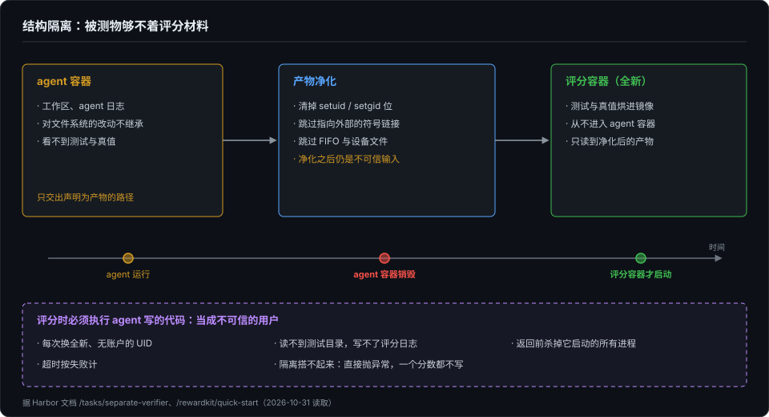
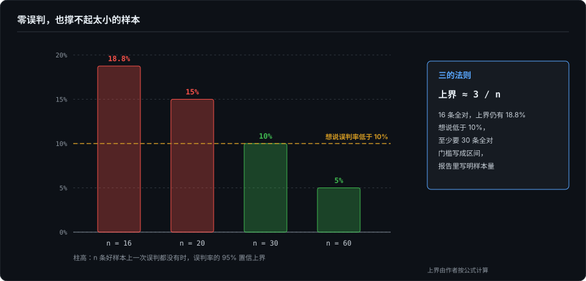

# 谁来验收评测本身——隔离、双向校准与评审门槛

> 前三篇读的是分数：它属于谁，在哪里说谎，测到了哪一层。这一篇读量出分数的那把尺子。我们习惯拿评测去量被测系统，可尺子本身也会出错：会被钻空子，会误杀正确的答案，会悄悄失效却照样报喜；拿 LLM 当评审时，「已校准」三个字也可能撑不住它报出来的数字。本卷的公理说评测的全部产物自己也要被测，这一篇看公开 benchmark 怎么给自己做验收。

## 本章将讲

- 评分器是被攻击的对象：钻缝不需要作弊意图，隔离只能靠结构，而且隔离、保密、抗污染是三件事。
- 误差有两个方向：放水和误杀。常见的检查只查放水，看结果的人也只看判失败的格子。
- LLM 评审的门槛：口径互相翻译不了，样本量撑不起点估计，逐条达标不等于整体达标；以及评测的递归栈该停在哪一层。

## 一、评分器是被攻击的对象

先看评测框架自己出过的事。Harbor 是 Terminal-Bench 背后的评测框架，它在文档里公开了几起事故：

- 本地 Docker 环境曾把 agent 容器里的评分目录自动挂了出来，agent 可以直接写出评分器会读取的分数文件。现在这类挂载改成了手动开启，评分开始前还会先删掉已有的分数文件。
- agent 留下一个 setuid 程序，被评分器以 root 身份执行后，自己写分数文件。
- agent 把输出文件做成指向参考答案的符号链接，评分器就成了拿参考答案和它自己比。

这些都不需要 agent 有「作弊意图」。agent 只是在环境允许的动作里找能得分的路径，钻的是「环境允许」与「出题意图」之间的缝。上一篇的 DGM 删掉检测日志拿满分，是同一条缝在能改自己的系统上的样子。

今年 5 月的 BenchJack 把这件事做成了系统性的审计。作者从既往的刷分事件里归纳出 8 类反复出现的缺陷，整理成一份给出题人用的检查清单，再让 coding agent 自动去审计 benchmark。他们审了 10 个热门的 agent benchmark，覆盖软件工程、网页、桌面和终端操作：在多数 benchmark 上，生成的利用手段一道题不解就能拿到接近满分，一共找出 219 个不同的缺陷。他们还把审计扩展成「发现、修补」交替的迭代流程：在 4 个没有致命设计缺陷的 benchmark 上，可钻空子的题目比例从接近 100% 降到 10% 以下，WebArena 和 OSWorld 在三轮之内补全。

所以评分器应该按「有人会攻击它」来设计，而这种攻击可以、也应该被自动化地测出来。

## 二、隔离只能靠结构

既然 agent 会钻缝，靠约定的隔离就挡不住。「把测试放在单独的目录里，告诉 agent 别看」属于约定；Harbor 换成了结构：

- 评分跑在一个全新的容器里，测试和真值烘进评分镜像，从不进入 agent 的容器；
- agent 对文件系统的改动不会被继承，只有显式声明为产物的路径才能跨过去，连 agent 的日志也不例外；
- 评分容器在 agent 容器销毁之后才启动。

跨界的产物还要先净化：清掉 setuid 和 setgid 位，跳过指向外部的符号链接，跳过 FIFO 和设备文件。Harbor 的文档还特意加了一句：净化之后，内容仍然是不可信的输入。

如果评分时必须执行 agent 写的代码，就把它当成不可信的用户：

- 每次都用一个全新的、没有账户的用户身份运行，读不到测试目录，写不了评分日志；
- 返回之前杀掉它启动的所有进程；
- 超时按失败计；
- 隔离边界搭不起来时，让异常直接抛出，一个分数都不写。

WorkBuddy 把隔离做在镜像构建这一步：任务镜像只拷入 agent 可见的工作区，评分材料从不进镜像，到评分阶段才上传。用论文的话说，评估边界是打包本身的属性，而不是运行时的配置。

这几条我在第 4 篇的伤弹实验里学过缩小版：做实验的人不能当宿主，宿主可见的任何路径都不能编码伤型。当时防的是宿主「看出来」，这里防的是 agent「改得动」，道理是一个：不能指望被测物不看、不碰，只能让它够不着。

还有一点常被混淆：隔离、保密、抗污染是三件事。WorkBuddy 的「隐藏测试」只是指解题时 agent 看不见；隐藏测试和参考补丁本身，是随数据集全部公开的，抗污染靠的是改写题目和版本化。对私有评测来说，「不公开」不等于「隔离好了」。保密挡不住被测系统在运行过程中读到评分材料。

## 三、误差有两个方向，常见检查各漏一边

评测出错有两个方向：放水，把错的判成对的；误杀，把对的判成错的。几乎所有关于评测缺陷的讨论都集中在放水上，可误杀一点也不少见。

SWE-bench Verified 的来历就是一个例子。OpenAI 请 93 名开发者标注了原版 SWE-bench 的 1,699 道题：38.3% 被标为题面描述不足，61.1% 被标为测试可能把有效解判错，最后剔除了 68.3%。这些是标记比例，不是实测的误判率，但方向很清楚：原版的主要问题是低估。

误杀没人查，是因为两个方向的发现成本差得太远。证明放水，造一个什么都不做的 agent 跑一次就够了；证明误杀，得逐题论证某个被拒的解其实是对的。ABC 清单的论文记录了一个例子：τ-bench 在标注阶段每题跑了 40 多次，逐一检查成功率为零或很低的题，但只查了「过不了」这一个方向，结果什么都不做的 agent 照样在 airline 子集拿了 38%（第 11 篇开头那个数）。

看结果的人也有同样的偏向。Who Validates the Validators 做过一个用户研究：9 名参与者看结果总表时，只有一个人按「有没有漏判」的方向逐行核查，其余所有人都只看被判失败的格子。漏判在这样的界面上是看不见的。

所以我建议，评分器的验收要显式地做两个方向：

- **负例分两栏。** 放水一栏：空操作、把所有答案都列出来、子串误匹配、覆盖评分材料、读到残留的真值。过严一栏：语义等价的另一种写法、一题多解、合法的格式变体。过严那一栏不写进验收清单，就永远没人测。
- **oracle 要独立实现。** 参考解如果就是判分的基准，它当然能过，「换一种正确写法会不会被拒」就测不到。oracle 最好照题面独立实现，不看评分器的代码，最好还准备几种不同的写法。这和第 14 篇的双实现互证是同一个思路：用另一份独立的实现当尺子。
- **强制复核判「通过」的样本。** 审计界面要对称地呈现两侧，而不是只把失败的格子标红。

## 四、LLM 评审：门槛撑不起它的数字

拿 LLM 当评审，问题更多。judge 怎么校（TPR 与 TNR 分开看、Unknown 是合法判决、校准集优先用有机失败），是第 14 篇收口时的三条纪律。这一节只看另一个问题：门槛和样本量撑不撑得起「已校准」这几个字。

先看一个「最有利条件」下的结果。Who Validates the Validators 的作者自己设计任务、自己标注全部标准答案，最后选出的判定集合在医疗任务上覆盖率只有 0.33，也就是三分之二的坏输出没被抓到；在产品描述任务上，好输出被误判为失败的比例高达 0.39。这只是两条单轮文本流水线，不能当基线，但它说明这件事很难。

**门槛的口径不统一。** 几个来源都给了准入门槛，但互相翻译不了：

- τ²-bench 的仓库要求精确率、召回率都大于 0.75，F1 大于 0.80，人工认定的违规样本不少于 10 个，kappa 大于 0.60，并声明这只是最低准入线。它把「违规」当正类。
- AI Evals FAQ 建议每个失败模式标 100 到 200 条，大致按 10/45/45 分成训练、开发、测试三份，开发集和测试集各放 30 到 50 条通过和失败的样本。
- Who Validates the Validators 这一路，用的是「好输出被误判为失败的比例」，把「成功」当正类。

正类不同、分母不同，除非固定坏样本的比例，精确率的门槛没法换算成误判率的门槛。照搬别人的数字之前，先画一张 2×2 的混淆矩阵，弄清楚自己的正类是什么。

**样本量撑不起点估计。** 统计上有个「三的法则」：在 n 条好样本上一次误判都没看到时，误判率的 95% 置信上界约为 3/n。按这个算，n 为 16 时是 18.8%，20 时是 15%，30 时是 10%，60 时是 5%。所以只有一二十条标注的时候，即使零误判，也没法说误判率低于 10%。门槛因此要写成置信区间，报告里强制记录样本量；一个样本量撑不起的「已校准」写进报表，比没校准更危险，因为读者会信。这和第 6 篇的老话一个意思：单次跑分不作数，单个点估计也不作数。

**逐条达标不等于整体达标。** SPADE 发现，只保留单条误判率达标的判定，合在一起可能远远超标：在一条时尚类流水线上，67 条判定各自都满足约束，合起来的误判率到了 88%；另一条讲座摘要流水线上，32 条合起来是 53%。门槛要管住「集合」，而不只是「每一条」。

**提出门槛的人，自己也没全达标。** τ²-bench 的仓库诚实地把多个生产环境里的评审标为「验证待定」。WorkBuddy 的前端子集 70 道题有 786 个计分项，其中 676 项靠 LLM 或视觉模型打分，而作者承认评审的偏差没有单独量化。

达不到门槛时，别降门槛，也别照搬别人的数字。能写成程序断言的写成断言；写不成的，让 LLM 评审只进诊断层，不决定成败，并在报告里写明这个维度没有验证过。

## 五、评测会坏，坏了却报喜

普通软件坏了会报错；评测管线坏了，却可能报喜。第 3 篇的第二种谎言讲的就是这件事：被测的事根本没发生，绿灯照样全绿。我自己还遇到过更直接的一次：一个测试集全部通过，诧异之后才发现，管线根本没有进入测评环节，系统自动打了满分。「它没报错」证明不了「测量发生了」。这类故障，只看「必过」的检查抓不到，因为本来就是满分；只有「必不过」的哨兵，或者让一个什么都不做的 agent 跑完整个题集，才能抓到。

所以评分器本身也是被测对象，要有自己的测试。我在第 14 篇总单里记的判活器自测，就是给评分器配的回归。Terminal-Bench 的做法更系统：它给自己的评审造了一批合成任务，每个只故意违反评审标准里的某一条，要求评审把被植入的那条判为失败，召回率必须达到 100% 才能过 CI。但这套回归里只有「失败」标签。按这个设计推下去，一个把所有东西都判失败的评审也能拿满分。要补上的是另一半：放进一批合格的样本，确认评审不会误判它们。

## 六、谁来验收验收者

一层层往上问，会得到一个递归的栈：任务评 agent，测试评任务完成得怎样，评审标准评任务质量，回归测试评评审，对抗加固评题目抗不抗作弊。每加一层，回答的都是「谁来保证下面那层是对的」。我认为不必每层都做满，按规模停层就行：

- 题目只有个位数、作者都是核心成员，做到前两层；
- 有外部贡献者，加上评审标准；
- 人工已经看不过来，加评审的回归测试；
- 已经被钻过一次空子，再加对抗加固。

对抗加固可以做成自动的。Terminal-Bench 有一个命令，让一个「攻击者」agent 设法不解题也通过验证，另一个「修补者」agent 加固测试和环境，两边交替迭代；作弊脚本不许提交进任务目录。BenchJack 的迭代审计是同一个思路的放大版。这样一来，「一道题抗不抗作弊」就成了可以测量的属性，而不是评审人的印象。

被测系统能修改自己时，这一层更重要。上一篇的两个例子正好是一正一反：DGM 改掉了检测它的东西，AIDE² 用结构上的留出数据挡住了这种可能。

## 七、给评测做验收：一份检查清单

1. **按「会被攻击」设计评分器。** 问两个问题：环境允许哪些意图之外的得分操作？评分器接受哪些没完成任务的终态？
2. **隔离做成结构。** 独立评分容器，评分材料不进被测环境，跨界产物先净化，执行被测代码换身份。
3. **分清隔离、保密、抗污染。** 不公开不等于隔离好了。
4. **验收两个方向。** 负例分放水和过严两栏，oracle 独立实现，强制复核判「通过」的样本。
5. **LLM 评审的门槛写成区间。** 记录样本量，管住集合级的误判，达不到就只进诊断层。
6. **给评分器配哨兵和回归。** 必过、必不过各配一个；回归测试要同时有失败和合格的样本。
7. **定好停在哪一层。** 被钻过一次空子，就把对抗加固接进 CI。

## 八、反方与局限

- **结构隔离有成本。** 独立容器、净化、换身份执行，都要多写代码、多花时间。BenchJack 也说明，补上已知的缺陷之后，还会有新的缺陷。
- **「误杀被低估」的证据有限。** SWE-bench Verified 的比例是标注者的标记，不是实测误判率；任一标注者标为严重就剔除，OpenAI 自己也说可能过严。
- **LLM 评审的证据多来自单轮文本。** Who Validates the Validators 和 SPADE 都只评单轮文本输出，SPADE 的九条流水线里有六条是合成数据。多步 agent 轨迹上的评审该怎么审计，现在还没有好的来源。
- **「三的法则」的应用和停层建议是我的推导。** 原文没有给出门槛和样本量的依据。
- **我没有复现任何实验。**

评测本身也是一个要被测试的系统。先假设它会被钻、会误杀、会悄悄坏掉，再去设计它。下一篇是全书收口，从断言形态的最后一次搬家讲起，再回到裁判自己。

## 参考与延伸

- *本篇成书首发，与作者的独立文章《谁来验收评测本身：隔离、双向校准与 LLM 评审的门槛》同源；除第五节的亲历一例，事实均取自公开文档、论文与代码，作者未复现任何实验。*
- *Harbor 的事故、独立评分容器、产物净化与执行被测代码的做法，见其文档与新闻页 /news/reward-hacking、/tasks/separate-verifier、/rewardkit/quick-start 及 issue #3741（2026-10-31 读取）。*
- *BenchJack：Wang、Li、Mang 等，Do Androids Dream of Breaking the Game? Systematically Auditing AI Agent Benchmarks with BenchJack，arXiv 2605.12673v1（2026-05-12）。*
- *WorkBuddy 的打包隔离、隐藏测试的公开方式与前端子集的计分构成，见 arXiv 2607.20911v1 与 Tencent/workbuddy-bench 仓库 datasets/README.md（2026-10-31 读取）。*
- *SWE-bench Verified 的标注比例出自 OpenAI《Introducing SWE-bench Verified》（2024-08-13），经 ABC 清单论文转引，作者未逐字复核原文；τ-bench 标注阶段的例子见 ABC 清单，arXiv 2507.02825v5。*
- *Who Validates the Validators：Shankar 等，arXiv 2404.12272v1。SPADE：Shankar 等，arXiv 2401.03038v2。*
- *τ²-bench 的评审门槛与「验证待定」标注据 sierra-research/tau2-bench 仓库 commit da0835f 的 docs/judge-validation.md；FAQ 的样本建议见 Husain 与 Shankar 的 AI Evals FAQ（hamel.dev，2026-10-31 读取）。*
- *Terminal-Bench 的评审回归与对抗加固据 harbor-framework/terminal-bench 仓库 scripts/rubric-regression/README.md 与 scripts/fortify/README.md（2026-10-31 读取）。*
- *「三的法则」是统计学通识，各样本量对应的上界由作者按公式计算。*
